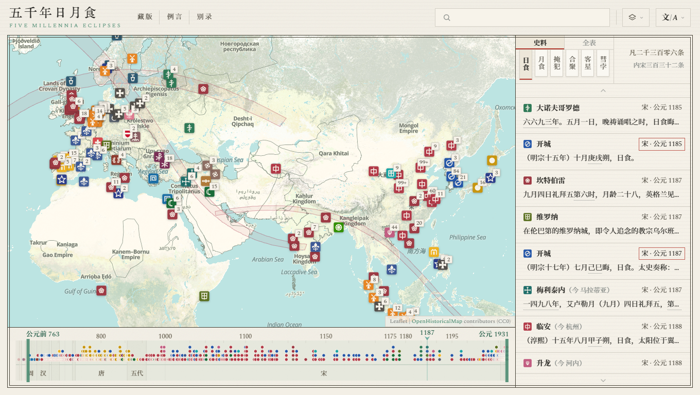
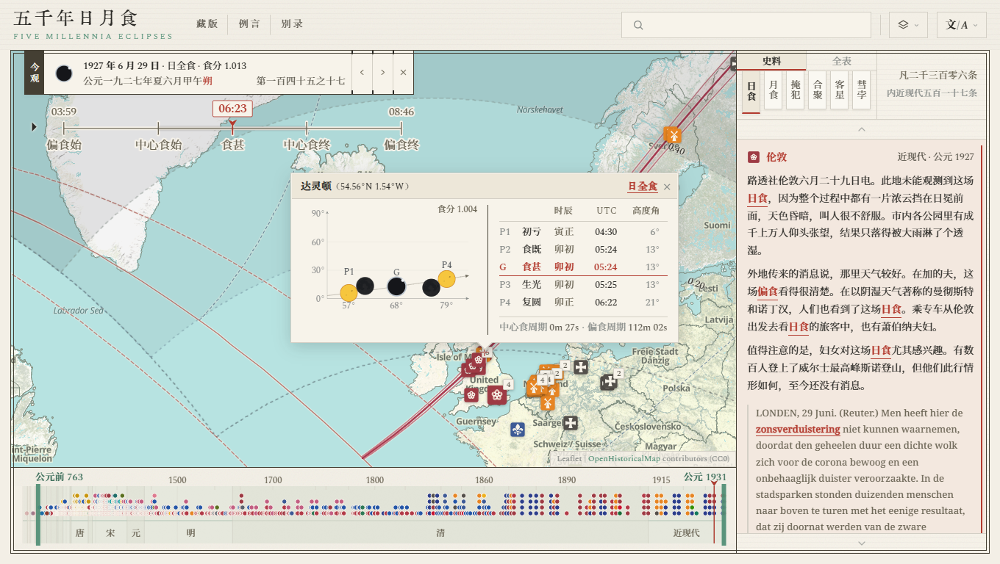
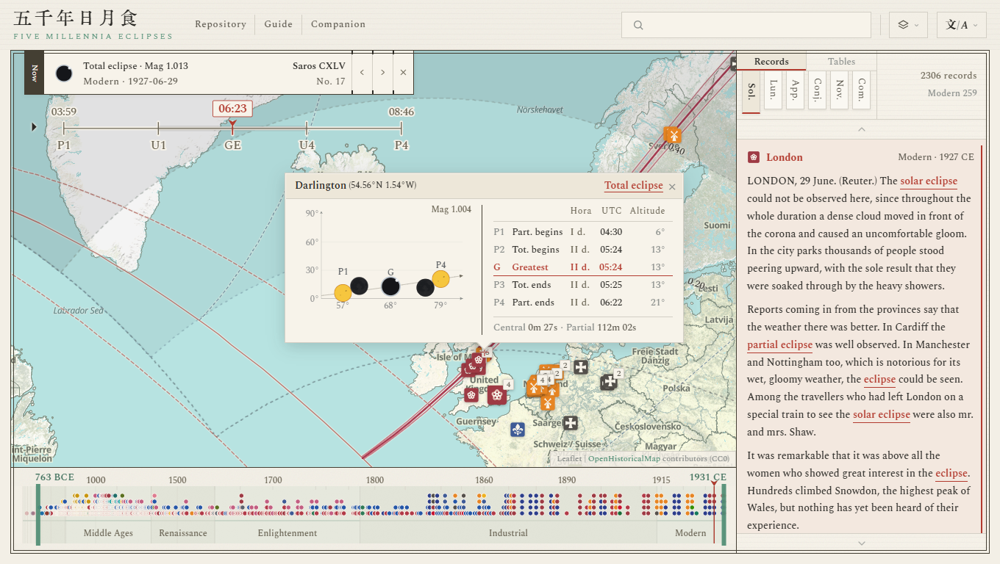

#  五千年日月食 · Five Millennia Eclipses

[简体中文](zh-Hans/README.md) · [繁體中文](zh-Hant/README.md) · [English](en/README.md) · [Français](fr/README.md) · [Español](es/README.md) · [Italiano](it/README.md) · [日本語](ja/README.md)

<p align="center">
  
</p>

**网站链接 / Website**：<https://higashimado.github.io/FiveMillenniaEclipses/>

「**五千年日月食**」是基于 Leaflet、MapLibre GL JS 地图架构与 JSONL 数据格式构建的开放历史天文记录数据库，其收录有各类公有领域的万余条历史天象记录，比对天文推算，整理日期、地点、对象、来源等标注，并呈现于统一的可交互历史地图之上。何时何地，何名何物，一览可稽。

**Five Millennia Eclipses** is an open database of astronomical records from history, built on the Leaflet and MapLibre GL JS mapping libraries and the JSONL data format. It holds more than ten thousand public-domain records of celestial phenomena, checks each one against astronomical computation, annotates its date, place, object and source, and presents them all on a single interactive historical map. For every record, the map shows at a glance when and where the event was seen, what it was called and what it actually was.

## 页面

网站主页面由顶栏、地图、历轴、右栏四部分组成，历轴居下，右栏居右：

- **顶栏**：搜索框可匹配原文、译文、注释、来源、地名、时间、文明等以筛选记录，选项框可切换地图底图和界面语言
- **地图**：[OpenHistoricalMap](https://www.openhistoricalmap.org/) 为默认底图，地图要素随年代变化，印章标示记录的所属文明与观测地点
- **历轴**：鱼眼时间轴，焦点可调节，附有年份刻度与朝代分界，圆点标示记录的观测时间
- **右栏**：分史料、全表两种视图，分别列出天象记录与天文事件，栏顶浮签用于切换天象类型

点击地图上的印章或列表中的条目，即可进入**事件详情**模式，该模式下：

- 地图将显示影锥的接触曲线和事件的可见范围，以及同场事件的各记录分布
- 书耳会列出事件的概况数据与干支纪日，书耳下的拨盘可逐时播放影锥投影
- 点击地图上的任意地点，将显示事件弹窗，上附该地推算的食况图与食程表


<p align="center">
  
</p>


## 史料

本库目前存有天象记录共 13 156 条，汉译文本约 56 万字。记录引自 387 种来源，涉汉文、荷兰语、法语、英语、拉丁语、阿拉伯语、希腊语等 23 种语言，取自 [维基文库](https://wikisource.org/)、[Delpher](https://www.delpher.nl/)、[Gallica](https://gallica.bnf.fr/)、[互联网档案馆](https://archive.org/)、[Chronicling America](https://chroniclingamerica.loc.gov/)、[台灣歷史數位圖書館](http://thdl.ntu.edu.tw/)、[德意志历史文献集成 dMGH](https://www.dmgh.de/) 与 [NASA ADS](https://ui.adsabs.harvard.edu/) 等 20 余个数字图书馆，所引文本版权均为公有。

### 体裁

依目的和形式的不同，本库记录的体裁可大致分为“史册”“报刊”“学志”“杂录”四类，此下再细分 22 种小类。小类记于 [`sources.json`](data/records/sources.json) 的 `genre` 字段。不同体裁的记录风格、主题、篇幅及详略各不相同，详见 [`SOURCES.md`](SOURCES.md)．

| 类别 | 小类 | 来源 | 条数 | 条数占比 | 汉译字数 | 字数占比 | 年代 |
|---|---:|---:|---:|---:|---:|---:|---|
| 史册 | 6 | 103 | 11 949 | 90.8% | 238 665 | 42.5% | 前 720 – 1911 |
| 报刊 | 6 | 186 | 1 003 | 7.6% | 281 545 | 50.2% | 1834 – 1941 |
| 学志 | 3 | 57 | 57 | 0.4% | 25 157 | 4.5% | 1715 – 1923 |
| 杂录 | 7 | 45 | 147 | 1.1% | 16 029 | 2.9% | 前 2137 – 1842 |
| **合计** | **22** | **387** | **13 156** | | **561 396** | | **前 2137 – 1941** |

**史册**以中、日、朝、越官修史书为主体，兼收西亚、欧洲编年史，载录连续、分类齐全、格式规整，典例有如[《宋史·天文志》](https://zh.wikisource.org/wiki/%E5%AE%8B%E5%8F%B2/%E5%8D%B7053)。**报刊**是近代产物，来源丰富、视角多样，既有富生活气息的市民群像，又有以天象喻事之社论杂文。**学志**为专业人士撰写，记录翔实、影响深远，最重要的莫如 1919 年验证广义相对论之日食观测 [*The Expedition to Sobral*](https://archive.org/details/philtrans06337895)．**杂录**则含经书、史著、诗歌、日记、书信与泥板等，如《诗经》之“日有食之，亦孔之醜”，上古记录尽出于此，然其所系年月、地点多有争议。

### 结构

史料数据存放于 [`data/records/`](data/records/)，以 JSONL 格式存储，按天象与文明分类。每条记录含原文、译文、注释，以及日期、地点、文明、来源、可信度等标注。该目录下的 [`manifest.json`](data/records/manifest.json) 存放文件列表与条目数量，[`sources.json`](data/records/sources.json) 存放书名、作者、卷页等来源信息，[`visibility.json`](data/records/visibility.json) 存放比对记录描述与天文推算所得的事件可见性。

| 文件 | 内容 | 调用 |
|---|---|---|
| [`data/records/README.md`](data/records/README.md) | 格式说明 | — |
| [`data/records/schema.json`](data/records/schema.json) | 字段定义 | — |
| [`data/records/manifest.json`](data/records/manifest.json) | 文件清单 | [`js/atlas.js`](js/atlas.js) |
| [`data/records/sources.json`](data/records/sources.json) | 来源目录 | [`js/atlas.js`](js/atlas.js) |
| [`data/records/visibility.json`](data/records/visibility.json) | 可见性 | [`js/atlas.js`](js/atlas.js) |
| [`data/records/`](data/records/) `<天象>/<文明>.jsonl` | 记录原件 | [`js/atlas.js`](js/atlas.js) |

`<天象>` 可取 `solar`、`lunar`、`appulse`、`conjunction`、`guest`、`comet`，与右栏的六类浮签一致。`<文明>` 可取 `chinese` 等 33 种，详见 [`civilizations.json`](data/concordance/civilizations.json)．

## 全表

本库的天文事件全表收录 [天文纪年](https://zh.wikipedia.org/zh-cn/天文计年) −3000 至 1999 年的日食 11 871 场、月食 12 031 场。日食的贝塞尔根数、月食的沙罗序号和伽马值取自 NASA/Espenak [五千年日月食典 5MCSE / 5MCLE](https://eclipse.gsfc.nasa.gov/)，接触曲线由 [SubstellarAtlas](https://github.com/Higashimado/SubstellarAtlas) 的几何工具计算。由于食典年代起自公元前 2000 年，更早年代无典可依，本库即按 [JPL DE441](https://ssd.jpl.nasa.gov/planets/eph_export.html) 星历自行推算，结果的经度标准差在 4.48° 到 7.30° 之间。

| 文件 | 内容 | 调用 | 条目 | 大小 |
|---|---|---|---:|---:|
| [`data/eclipses/README.md`](data/eclipses/README.md) | 格式说明 | — | | |
| [`data/eclipses/solar.json`](data/eclipses/solar.json) | 日食索引 | [`js/eclipse-loader.js`](js/eclipse-loader.js) | 11 871 | 9.7 MB |
| [`data/eclipses/lunar.json`](data/eclipses/lunar.json) | 月食索引 | [`js/eclipse-loader.js`](js/eclipse-loader.js) | 12 031 | 9.7 MB |
| [`data/eclipses/events/`](data/eclipses/events/) `<日期>.json` | 接触曲线与贝塞尔多项式 | [`js/eclipse.js`](js/eclipse.js) | 11 871 | 386 MB |
| [`data/eclipses/bessel-5mcse.json`](data/eclipses/bessel-5mcse.json) | 5MCSE 贝塞尔根数 | — | 9 506 | 5.8 MB |
| [`data/eclipses/bessel-ancient.json`](data/eclipses/bessel-ancient.json) | DE441 自算贝塞尔根数 | — | 2 365 | 2.1 MB |

`<日期>` 为 [ISO 8601](https://web.archive.org/web/20171019211402/https://www.loc.gov/standards/datetime/ISO_DIS%208601-1.pdf) 定义的天文日期，如 `-000762-06-07`、`1931-10-11`．

## 对照

本库的对照表用于统一多源异名对象的元数据信息，如天文对象的“荧惑”之于“火星”，地理对象的“应天”之于“南京”等，以作史料和全表相关字段的凭据。例如，[`gazetteer.json`](data/concordance/gazetteer.json) 存放天象记录中观测地的名称、坐标，[`xingguan.json`](data/concordance/xingguan.json) 存放星官的名称、范围与连线，[`eras.json`](data/concordance/eras.json) 存放中、日、越、西夏年号的名称、朝代及对应的天文纪年。同一对象或有简写、别名，或在不同的时间范围内有特定名称，详见各文件头部 `_meta` 字段的定义。

| 文件 | 内容 | 调用 | 条目 |
|---|---|---|---:|
| [`data/concordance/README.md`](data/concordance/README.md) | 格式说明 | — | |
| [`data/concordance/gazetteer.json`](data/concordance/gazetteer.json) | 地点 | [`js/atlas.js`](js/atlas.js)、[`js/place-name.js`](js/place-name.js) | 565 |
| [`data/concordance/regions.json`](data/concordance/regions.json) | 区域 | [`js/atlas.js`](js/atlas.js)、[`js/place-name.js`](js/place-name.js) | 124 |
| [`data/concordance/civilizations.json`](data/concordance/civilizations.json) | 文明 | [`js/atlas.js`](js/atlas.js)、[`js/seal.js`](js/seal.js) | 33 |
| [`data/concordance/organizations.json`](data/concordance/organizations.json) | 机构名称 | — | 52 |
| [`data/concordance/xingguan.json`](data/concordance/xingguan.json) | 中国星名 | — | 407 |
| [`data/concordance/eras.json`](data/concordance/eras.json) | 年号 | [`js/atlas.js`](js/atlas.js) | 830 |

## 运行

本库前端为静态站点，无构建步骤，本地预览需有 [Node.js](https://nodejs.org/)，克隆源码后在根目录执行：

```bash
npm start
```

随后，在浏览器打开 <http://localhost:8002>，检查是否正常显示即可。

## 目录

- [`index.html`](index.html)、[`js/`](js/)、[`css/`](css/)：前端页面
- [`vendor/`](vendor/)：外部库
- [`data/`](data/)：史料、全表、对照与多语言，格式约定见 [`data/README.md`](data/README.md)
- [`licenses/`](licenses/)：许可全文
- [`serve.mjs`](serve.mjs)：本地预览

## 致谢与许可

本项目自有代码以 [**GNU General Public License v3.0**](LICENSE) 发布。[`data/records/`](data/records/)、[`data/eclipses/`](data/eclipses/) 与 [`data/concordance/`](data/concordance/) 以 [**CC-BY-SA 4.0**](licenses/data/CC-BY-SA-4.0.txt) 发布。第三方代码、数据与字体遵循各自的许可，署名详见 [`ATTRIBUTION.md`](ATTRIBUTION.md)．

| 用途 | 组件（版本） | 作者或来源 | 许可 |
|---|---|---|---|
| 影锥几何 | [SubstellarAtlas](https://github.com/Higashimado/SubstellarAtlas) | Higashimado | GPL-3.0 |
| 地图引擎 | [Leaflet](https://leafletjs.com/) 1.9.4 | Volodymyr Agafonkin | BSD-2-Clause |
| 矢量渲染 | [MapLibre GL JS](https://maplibre.org/) 5.24.0 | MapLibre | BSD-3-Clause |
| 图层桥接 | [maplibre-gl-leaflet](https://github.com/maplibre/maplibre-gl-leaflet) 0.1.3 | MapLibre | ISC |
| 时间过滤 | [maplibre-gl-dates](https://github.com/OpenHistoricalMap/maplibre-gl-dates) 1.3.0 | OpenHistoricalMap | CC0-1.0 |
| 天文计算 | [Astronomy Engine](https://github.com/cosinekitty/astronomy) 2.1.19 | Don Cross | MIT |
| 日月食典 | [5MCSE / 5MCLE](https://eclipse.gsfc.nasa.gov/) | Fred Espenak（NASA GSFC） | 公有领域，须署名 |
| 古代星历 | [JPL DE441](https://ssd.jpl.nasa.gov/planets/eph_export.html) | JPL | 公有领域 |
| 自转误差 | [Stephenson, Morrison & Hohenkerk 2016](https://doi.org/10.1098/rspa.2016.0404) | Royal Society | CC BY 4.0 |
| 史料底本 | [维基文库](https://wikisource.org/) | Wikisource 贡献者 | CC-BY-SA 4.0 |
| 史料底本 | [Delpher](https://www.delpher.nl/)、[Gallica](https://gallica.bnf.fr/)、[互联网档案馆](https://archive.org/)、[Chronicling America](https://chroniclingamerica.loc.gov/) 等 | 各收藏机构 | 公有领域 |
| 历史底图 | [OpenHistoricalMap](https://www.openhistoricalmap.org/) | OHM 社区 | 数据 CC0 |
| 现代底图 | [CARTO](https://carto.com/) Positron · Voyager | CARTO | © CARTO |
| 现代底图 | [OpenStreetMap](https://www.openstreetmap.org/) 标准图层 | OSM 贡献者 | ODbL |
| 地形底图 | [Esri World Shaded Relief](https://www.esri.com/) | Esri / USGS | © Esri |
| 底图数据 | [OpenStreetMap](https://www.openstreetmap.org/copyright) | OSM 贡献者 | ODbL |
| CJK 字体 | [Source Han Serif](https://github.com/adobe-fonts/source-han-serif) 思源宋体 | Adobe | OFL |
| 西文字体 | [Spectral](https://fonts.google.com/specimen/Spectral) | Production Type | OFL |
| 衬线字体 | [Noto Serif](https://fonts.google.com/noto) · Naskh Arabic · Serif Armenian · Serif Hebrew | Google | OFL |
| 题铭字体 | [KingHwaOldSong](https://fonts.zeoseven.com/) 京華老宋体 | ZeoSeven Fonts | 见[授权文件](licenses/fonts/KingHwaOldSong-LICENSE.md) |

本库史料浩繁，疏漏、讹误在所难免。如有补遗、勘误或示以考证，欢迎在 [issues](https://github.com/Higashimado/FiveMillenniaEclipses/issues) 留言指正。

---

## Interface

The main page has four parts: the top bar, the map, the timeline and the side panel. The timeline runs along the bottom and the side panel sits on the right.

- **Top bar**: the search box filters records by original text, translation, note, source, place name, date or civilization, and the menus switch the basemap and the interface language.
- **Map**: [OpenHistoricalMap](https://www.openhistoricalmap.org/) is the default basemap, and its features change with the period shown. Seals mark the civilization and the place of observation of each record.
- **Timeline**: a fisheye timeline with an adjustable focus, year ticks and period boundaries. Dots mark the times at which records were observed.
- **Side panel**: the Records view lists the records of phenomena and the Tables view lists the astronomical events. Tabs at the top of the panel switch between types of phenomena.

Clicking a seal on the map or an entry in the list opens **event details**. In this mode:

- The map shows the contact curves of the shadow cone and the area where the event was visible, along with the places of all the records of the same event.
- The cartouche lists the event's key figures and its sexagenary day, and the dial below it plays the projection of the shadow cone hour by hour.
- Clicking any place on the map opens an event popup with the eclipse diagram and the timetable of contacts computed for that place.

<p align="center">
  
</p>

## Records

The corpus currently holds 13,156 records of celestial phenomena, and their English translations total about 560,000 words. The records come from 387 sources in 23 languages, among them Classical Chinese, Dutch, French, English, Latin, Arabic and Greek. They were taken from more than 20 digital libraries, including [Wikisource](https://wikisource.org/), [Delpher](https://www.delpher.nl/), [Gallica](https://gallica.bnf.fr/), the [Internet Archive](https://archive.org/), [Chronicling America](https://chroniclingamerica.loc.gov/), the [Taiwan History Digital Library](http://thdl.ntu.edu.tw/), the [Monumenta Germaniae Historica (dMGH)](https://www.dmgh.de/) and [NASA ADS](https://ui.adsabs.harvard.edu/). Every text quoted is in the public domain.

### Genres

By purpose and form, the records fall into four broad classes, Histories, Newspapers, Learned writings and Miscellanea, which divide further into 22 subgenres. The subgenre is stored in the `genre` field of [`sources.json`](data/records/sources.json). The classes differ in style, subject, length and level of detail; see [`SOURCES.md`](SOURCES.md) for the full list of sources.

| Class | Subgenres | Sources | Records | Share of records | English words | Share of words | Period |
|---|---:|---:|---:|---:|---:|---:|---|
| Histories | 6 | 103 | 11,949 | 90.8% | 311,166 | 55.2% | 720 BCE – 1911 |
| Newspapers | 6 | 186 | 1,003 | 7.6% | 220,964 | 39.2% | 1834 – 1941 |
| Learned writings | 3 | 57 | 57 | 0.4% | 18,950 | 3.4% | 1715 – 1923 |
| Miscellanea | 7 | 45 | 147 | 1.1% | 12,159 | 2.2% | 2137 BCE – 1842 |
| **Total** | **22** | **387** | **13,156** | | **563,239** | | **2137 BCE – 1941** |

**Histories** are chiefly the official histories of China, Japan, Korea and Vietnam, joined by chronicles from Western Asia and Europe. Their entries run in unbroken series, are systematically classified and follow a set format; the [Treatise on Astronomy in the *History of Song*](https://zh.wikisource.org/wiki/%E5%AE%8B%E5%8F%B2/%E5%8D%B7053) is a typical example. **Newspapers** belong to the modern era and come from many hands and points of view, ranging from lively scenes of townspeople in the street to editorials and essays that read the sky as a comment on public affairs. **Learned writings** are the work of astronomers and other scholars and go into great detail; the most consequential of them are the 1919 eclipse observations that confirmed general relativity, [*The Expedition to Sobral*](https://archive.org/details/philtrans06337895). **Miscellanea** take in classics, historical works, poems, diaries, letters and clay tablets, such as the line of the *Classic of Poetry* rendered by Legge as "The sun was eclipsed; a thing of very evil omen." All of the earliest records belong to this class, though the dates and places assigned to many of them are disputed.

### Structure

The record data are stored as JSONL under [`data/records/`](data/records/), grouped by phenomenon and civilization. Each record holds its original text, translations and note, together with annotations of date, place, civilization, source, confidence and more. In the same directory, [`manifest.json`](data/records/manifest.json) holds the file list and record counts, [`sources.json`](data/records/sources.json) holds titles, authors, volumes, pages and other source details, and [`visibility.json`](data/records/visibility.json) holds the visibility of each event, found by comparing what the record describes with astronomical computation.

| File | Contents | Used by |
|---|---|---|
| [`data/records/README.md`](data/records/README.md) | Format notes | — |
| [`data/records/schema.json`](data/records/schema.json) | Field definitions | — |
| [`data/records/manifest.json`](data/records/manifest.json) | File inventory | [`js/atlas.js`](js/atlas.js) |
| [`data/records/sources.json`](data/records/sources.json) | Source catalogue | [`js/atlas.js`](js/atlas.js) |
| [`data/records/visibility.json`](data/records/visibility.json) | Visibility | [`js/atlas.js`](js/atlas.js) |
| [`data/records/`](data/records/) `<phenomenon>/<civilization>.jsonl` | The records | [`js/atlas.js`](js/atlas.js) |

`<phenomenon>` is one of `solar`, `lunar`, `appulse`, `conjunction`, `guest` and `comet`, matching the six tabs of the side panel. `<civilization>` is one of 33 values such as `chinese`; see [`civilizations.json`](data/concordance/civilizations.json).

## Tables

The tables of astronomical events cover the years −3000 to 1999 in [astronomical year numbering](https://en.wikipedia.org/wiki/Astronomical_year_numbering), with 11,871 solar eclipses and 12,031 lunar eclipses. The Besselian elements of the solar eclipses, and the saros numbers and gamma values of the lunar eclipses, are taken from NASA/Espenak's [*Five Millennium Canon* of solar and lunar eclipses (5MCSE / 5MCLE)](https://eclipse.gsfc.nasa.gov/). The contact curves are computed with the geometry tools of [SubstellarAtlas](https://github.com/Higashimado/SubstellarAtlas). The canons begin in 2000 BCE, so for the earlier years the project derives its own elements from the [JPL DE441](https://ssd.jpl.nasa.gov/planets/eph_export.html) ephemeris; the standard deviation of the resulting longitudes lies between 4.48° and 7.30°.

| File | Contents | Used by | Entries | Size |
|---|---|---|---:|---:|
| [`data/eclipses/README.md`](data/eclipses/README.md) | Format notes | — | | |
| [`data/eclipses/solar.json`](data/eclipses/solar.json) | Solar eclipse index | [`js/eclipse-loader.js`](js/eclipse-loader.js) | 11,871 | 9.7 MB |
| [`data/eclipses/lunar.json`](data/eclipses/lunar.json) | Lunar eclipse index | [`js/eclipse-loader.js`](js/eclipse-loader.js) | 12,031 | 9.7 MB |
| [`data/eclipses/events/`](data/eclipses/events/) `<date>.json` | Contact curves and Besselian polynomials | [`js/eclipse.js`](js/eclipse.js) | 11,871 | 386 MB |
| [`data/eclipses/bessel-5mcse.json`](data/eclipses/bessel-5mcse.json) | Besselian elements from 5MCSE | — | 9,506 | 5.8 MB |
| [`data/eclipses/bessel-ancient.json`](data/eclipses/bessel-ancient.json) | Besselian elements computed from DE441 | — | 2,365 | 2.1 MB |

`<date>` is an astronomical date as defined by [ISO 8601](https://web.archive.org/web/20171019211402/https://www.loc.gov/standards/datetime/ISO_DIS%208601-1.pdf), such as `-000762-06-07` or `1931-10-11`.

## Concordance

The concordance tables unify the metadata of objects that different sources know by different names, such as Yinghuo (荧惑) for Mars among celestial objects, or Yingtian (应天) for Nanjing among places. They are the authority behind the related fields of the records and the tables. For example, [`gazetteer.json`](data/concordance/gazetteer.json) holds the names and coordinates of the places of observation, [`xingguan.json`](data/concordance/xingguan.json) holds the names, extents and connecting lines of the Chinese asterisms, and [`eras.json`](data/concordance/eras.json) holds the Chinese, Japanese, Vietnamese and Western Xia era names with their dynasties and the corresponding astronomical years. An object may have short forms and aliases, or bear a particular name during a particular span of time; the `_meta` field at the head of each file defines how these are recorded.

| File | Contents | Used by | Entries |
|---|---|---|---:|
| [`data/concordance/README.md`](data/concordance/README.md) | Format notes | — | |
| [`data/concordance/gazetteer.json`](data/concordance/gazetteer.json) | Places | [`js/atlas.js`](js/atlas.js), [`js/place-name.js`](js/place-name.js) | 565 |
| [`data/concordance/regions.json`](data/concordance/regions.json) | Regions | [`js/atlas.js`](js/atlas.js), [`js/place-name.js`](js/place-name.js) | 124 |
| [`data/concordance/civilizations.json`](data/concordance/civilizations.json) | Civilizations | [`js/atlas.js`](js/atlas.js), [`js/seal.js`](js/seal.js) | 33 |
| [`data/concordance/organizations.json`](data/concordance/organizations.json) | Institution names | — | 52 |
| [`data/concordance/xingguan.json`](data/concordance/xingguan.json) | Chinese star names | — | 407 |
| [`data/concordance/eras.json`](data/concordance/eras.json) | Era names | [`js/atlas.js`](js/atlas.js) | 830 |

## Running locally

The front end is a static site with no build step. A local preview needs [Node.js](https://nodejs.org/). After cloning the repository, run this in its root directory:

```bash
npm start
```

Then open <http://localhost:8002> in a browser and check that the site displays correctly.

## Layout

- [`index.html`](index.html), [`js/`](js/), [`css/`](css/): the front-end pages
- [`vendor/`](vendor/): third-party libraries
- [`data/`](data/): records, tables, concordance and localization; conventions in [`data/README.md`](data/README.md)
- [`licenses/`](licenses/): full license texts
- [`serve.mjs`](serve.mjs): the local preview server

## Credits and license

The project's own code is released under the [**GNU General Public License v3.0**](LICENSE). [`data/records/`](data/records/), [`data/eclipses/`](data/eclipses/) and [`data/concordance/`](data/concordance/) are released under [**CC-BY-SA 4.0**](licenses/data/CC-BY-SA-4.0.txt). Third-party code, data and fonts keep their own licenses, and the full attributions are in [`ATTRIBUTION.md`](ATTRIBUTION.md).

| Purpose | Component (version) | Author or source | License |
|---|---|---|---|
| Shadow geometry | [SubstellarAtlas](https://github.com/Higashimado/SubstellarAtlas) | Higashimado | GPL-3.0 |
| Map engine | [Leaflet](https://leafletjs.com/) 1.9.4 | Volodymyr Agafonkin | BSD-2-Clause |
| Vector rendering | [MapLibre GL JS](https://maplibre.org/) 5.24.0 | MapLibre | BSD-3-Clause |
| Layer bridge | [maplibre-gl-leaflet](https://github.com/maplibre/maplibre-gl-leaflet) 0.1.3 | MapLibre | ISC |
| Date filtering | [maplibre-gl-dates](https://github.com/OpenHistoricalMap/maplibre-gl-dates) 1.3.0 | OpenHistoricalMap | CC0-1.0 |
| Astronomical computation | [Astronomy Engine](https://github.com/cosinekitty/astronomy) 2.1.19 | Don Cross | MIT |
| Eclipse canons | [5MCSE / 5MCLE](https://eclipse.gsfc.nasa.gov/) | Fred Espenak (NASA GSFC) | Public domain, attribution requested |
| Ancient ephemeris | [JPL DE441](https://ssd.jpl.nasa.gov/planets/eph_export.html) | JPL | Public domain |
| Earth rotation | [Stephenson, Morrison & Hohenkerk 2016](https://doi.org/10.1098/rspa.2016.0404) | Royal Society | CC BY 4.0 |
| Source texts | [Wikisource](https://wikisource.org/) | Wikisource contributors | CC-BY-SA 4.0 |
| Source texts | [Delpher](https://www.delpher.nl/), [Gallica](https://gallica.bnf.fr/), [Internet Archive](https://archive.org/), [Chronicling America](https://chroniclingamerica.loc.gov/) and others | The holding institutions | Public domain |
| Historical basemap | [OpenHistoricalMap](https://www.openhistoricalmap.org/) | OHM community | Data CC0 |
| Modern basemap | [CARTO](https://carto.com/) Positron · Voyager | CARTO | © CARTO |
| Modern basemap | [OpenStreetMap](https://www.openstreetmap.org/) standard layer | OSM contributors | ODbL |
| Relief basemap | [Esri World Shaded Relief](https://www.esri.com/) | Esri / USGS | © Esri |
| Basemap data | [OpenStreetMap](https://www.openstreetmap.org/copyright) | OSM contributors | ODbL |
| CJK font | [Source Han Serif](https://github.com/adobe-fonts/source-han-serif) | Adobe | OFL |
| Latin font | [Spectral](https://fonts.google.com/specimen/Spectral) | Production Type | OFL |
| Serif fonts | [Noto Serif](https://fonts.google.com/noto) · Naskh Arabic · Serif Armenian · Serif Hebrew | Google | OFL |
| Title font | [KingHwaOldSong](https://fonts.zeoseven.com/) | ZeoSeven Fonts | See the [license file](licenses/fonts/KingHwaOldSong-LICENSE.md) |

With so many records, some omissions and errors are unavoidable. Additions, corrections and challenges backed by evidence are welcome in the [issues](https://github.com/Higashimado/FiveMillenniaEclipses/issues).
