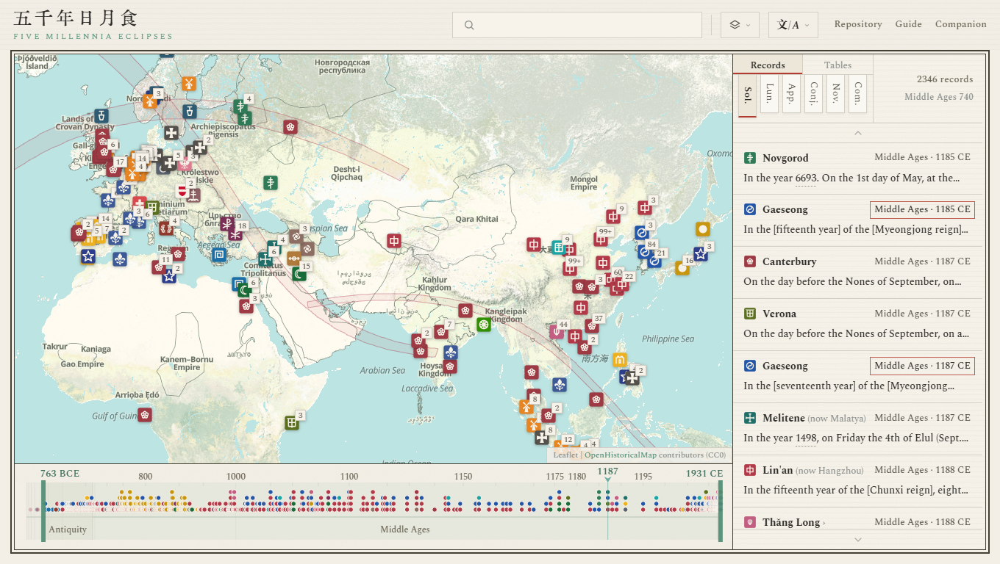
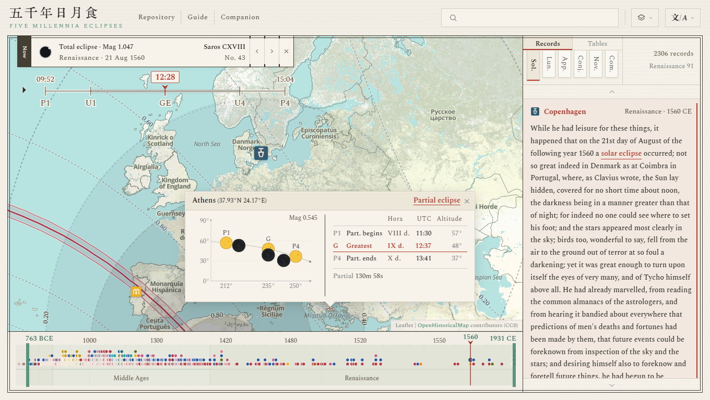
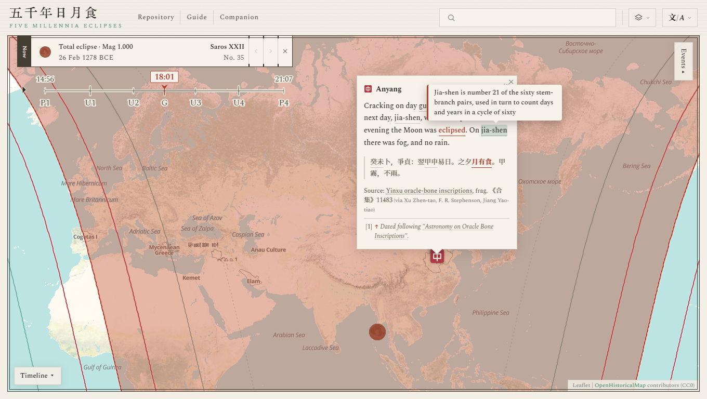
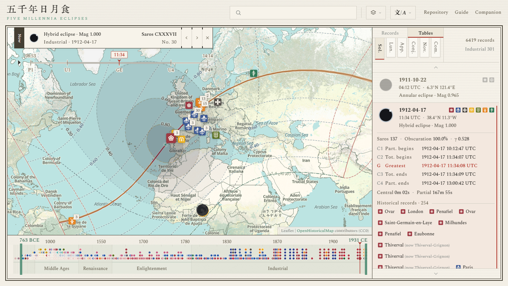

#  Five Millennia Eclipses

[简体中文](../zh-Hans/README.md) · [繁體中文](../zh-Hant/README.md) · **English** · [Français](../fr/README.md) · [Español](../es/README.md) · [Italiano](../it/README.md) · [日本語](../ja/README.md)

<p align="center">
  
</p>

**Site**: <https://higashimado.github.io/FiveMillenniaEclipses/>

**Five Millennia Eclipses** is an open database of astronomical records from history, built on the Leaflet and MapLibre GL JS mapping libraries and the JSONL data format. It holds more than ten thousand public-domain records of celestial phenomena, checks each one against astronomical computation, annotates its date, place, object and source, and presents them all on a single interactive historical map. For every record, the map shows at a glance when and where the event was seen, what it was called and what it actually was.

## Interface

The main page has four parts: the top bar, the map, the timeline and the side panel. The timeline runs along the bottom and the side panel sits on the right.

- **Top bar**: the search box matches a record's original text, translation, footnotes, source, place name, date, civilization and more, and the menus on the right switch the basemap and the language.
- **Map**: [OpenHistoricalMap](https://www.openhistoricalmap.org/) is the default basemap, and its features change with the period shown. Seals on the map mark the civilization and the place of observation of each record.
- **Timeline**: a fisheye timeline that spreads out the years near its focus and packs the distant ones closer together. The focus is adjustable, and the axis carries year ticks and period boundaries. Dots mark the times at which records were observed.
- **Side panel**: the Records view lists the records of phenomena and the Tables view lists the astronomical events. Tabs at the top of the panel switch between types of phenomena, and the pane at the top right shows the total number of entries.

Clicking a seal on the map or an entry in the list opens **event details**. In this mode:

- The map shows the contact curves of the shadow cone and the area where the event was visible, along with the places of all the records of the same event.
- The cartouche lists the event's key figures and its sexagenary day, and the dial below it plays the projection of the shadow cone hour by hour.
- Clicking any place on the map opens an event popup with the eclipse diagram and the timetable of contacts computed for that place.

<p align="center">
  
</p>

## Records

The corpus currently holds 13,195 records of celestial phenomena, and their English translations total about 570,000 words. The records come from 387 sources in 23 languages, among them Classical Chinese, Dutch, French, English, Latin, Arabic and Greek. They were taken from more than 20 digital libraries, including [Wikisource](https://wikisource.org/), [Delpher](https://www.delpher.nl/), [Gallica](https://gallica.bnf.fr/), the [Internet Archive](https://archive.org/), [Chronicling America](https://chroniclingamerica.loc.gov/), the [Taiwan History Digital Library](http://thdl.ntu.edu.tw/), the [Monumenta Germaniae Historica (dMGH)](https://www.dmgh.de/) and [NASA ADS](https://ui.adsabs.harvard.edu/). Every text quoted is in the public domain.

### Genres

By purpose and form, the records fall into four broad classes, Histories, Newspapers, Learned writings and Miscellanea, which divide further into 22 subgenres. The subgenre is stored in the `genre` field of [`sources.json`](../data/records/sources.json). The classes differ in style, subject, length and level of detail; see [`SOURCES.md`](../SOURCES.md) for the full list of sources.

| Class | Subgenres | Sources | Records | Share of records | English words | Share of words | Period |
|---|---:|---:|---:|---:|---:|---:|---|
| Histories | 6 | 103 | 11,948 | 90.5% | 312,374 | 54.3% | 720 BCE – 1911 |
| Newspapers | 6 | 186 | 1,043 | 7.9% | 228,462 | 39.7% | 1834 – 1941 |
| Learned writings | 3 | 57 | 57 | 0.4% | 21,327 | 3.7% | 1715 – 1923 |
| Miscellanea | 7 | 45 | 147 | 1.1% | 12,739 | 2.2% | 2137 BCE – 1842 |
| **Total** | **22** | **387** | **13,195** | | **574,902** | | **2137 BCE – 1941** |

**Histories** are chiefly the official histories of China, Japan, Korea and Vietnam, joined by chronicles from Western Asia and Europe. Their entries run in unbroken series, are systematically classified and follow a set format; the [Treatise on Astronomy in the *History of Song*](https://zh.wikisource.org/wiki/%E5%AE%8B%E5%8F%B2/%E5%8D%B7053) is a typical example. **Newspapers** belong to the modern era and come from many hands and points of view, ranging from lively scenes of townspeople in the street to editorials and essays that read the sky as a comment on public affairs. **Learned writings** are the work of astronomers and other scholars and go into great detail; the most consequential of them are the 1919 eclipse observations that confirmed general relativity, [*The Expedition to Sobral*](https://archive.org/details/philtrans06337895). **Miscellanea** take in classics, historical works, poems, diaries, letters and clay tablets, such as the line of the *Classic of Poetry* rendered by Legge as "The sun was eclipsed; a thing of very evil omen." All of the earliest records belong to this class, though the dates and places assigned to many of them are disputed.

<p align="center">
  
</p>

### Structure

The record data are stored as JSONL under [`data/records/`](../data/records/), grouped by phenomenon and civilization. Each record holds its original text, translations and note, together with annotations of date, place, civilization, source, confidence and more. In the same directory, [`manifest.json`](../data/records/manifest.json) holds the file list and record counts, [`sources.json`](../data/records/sources.json) holds titles, authors, volumes, pages and other source details, and [`visibility.json`](../data/records/visibility.json) holds the visibility of each event, found by comparing what the record describes with astronomical computation.

| File | Contents | Used by |
|---|---|---|
| [`data/records/README.md`](../data/records/README.md) | Format notes | — |
| [`data/records/schema.json`](../data/records/schema.json) | Field definitions | — |
| [`data/records/manifest.json`](../data/records/manifest.json) | File inventory | [`js/atlas.js`](../js/atlas.js) |
| [`data/records/sources.json`](../data/records/sources.json) | Source catalogue | [`js/atlas.js`](../js/atlas.js) |
| [`data/records/visibility.json`](../data/records/visibility.json) | Visibility | [`js/atlas.js`](../js/atlas.js) |
| [`data/records/`](../data/records/) `<phenomenon>/<civilization>.jsonl` | The records | [`js/atlas.js`](../js/atlas.js) |

`<phenomenon>` is one of `solar`, `lunar`, `appulse`, `conjunction`, `guest` and `comet`, matching the six tabs of the side panel. `<civilization>` is one of 33 values such as `chinese`; see [`civilizations.json`](../data/concordance/civilizations.json).

## Tables

The tables of astronomical events cover the years −3000 to 1999 in [astronomical year numbering](https://en.wikipedia.org/wiki/Astronomical_year_numbering), with 11,871 solar eclipses and 12,031 lunar eclipses. The Besselian elements of the solar eclipses, and the saros numbers and gamma values of the lunar eclipses, are taken from NASA/Espenak's [*Five Millennium Canon* of solar and lunar eclipses (5MCSE / 5MCLE)](https://eclipse.gsfc.nasa.gov/). The contact curves are computed with the geometry tools of [SubstellarAtlas](https://github.com/Higashimado/SubstellarAtlas). The canons begin in 2000 BCE, so for the earlier years the project derives its own elements from the [JPL DE441](https://ssd.jpl.nasa.gov/planets/eph_export.html) ephemeris; the standard deviation of the resulting longitudes lies between 4.48° and 7.30°.

| File | Contents | Used by | Entries | Size |
|---|---|---|---:|---:|
| [`data/eclipses/README.md`](../data/eclipses/README.md) | Format notes | — | | |
| [`data/eclipses/solar.json`](../data/eclipses/solar.json) | Solar eclipse index | [`js/eclipse-loader.js`](../js/eclipse-loader.js) | 11,871 | 9.7 MB |
| [`data/eclipses/lunar.json`](../data/eclipses/lunar.json) | Lunar eclipse index | [`js/eclipse-loader.js`](../js/eclipse-loader.js) | 12,031 | 9.7 MB |
| [`data/eclipses/events/`](../data/eclipses/events/) `<date>.json` | Contact curves and Besselian polynomials | [`js/eclipse.js`](../js/eclipse.js) | 11,871 | 386 MB |
| [`data/eclipses/bessel-5mcse.json`](../data/eclipses/bessel-5mcse.json) | Besselian elements from 5MCSE | — | 9,506 | 5.8 MB |
| [`data/eclipses/bessel-ancient.json`](../data/eclipses/bessel-ancient.json) | Besselian elements computed from DE441 | — | 2,365 | 2.1 MB |

`<date>` is an astronomical date as defined by [ISO 8601](https://web.archive.org/web/20171019211402/https://www.loc.gov/standards/datetime/ISO_DIS%208601-1.pdf), such as `-000762-06-07` or `1931-10-11`.

<p align="center">
  
</p>

## Concordance

The concordance tables unify the metadata of objects that different sources know by different names, such as Yinghuo (荧惑) for Mars among celestial objects, or Yingtian (应天) for Nanjing among places. They are the authority behind the related fields of the records and the tables. For example, [`gazetteer.json`](../data/concordance/gazetteer.json) holds the names and coordinates of the places of observation, [`xingguan.json`](../data/concordance/xingguan.json) holds the names, extents and connecting lines of the Chinese asterisms, and [`eras.json`](../data/concordance/eras.json) holds the Chinese, Korean, Japanese, Vietnamese and Western Xia era names with their dynasties and the corresponding astronomical years. Further tables cover persons, calendars, terms and more. The `_meta` field at the head of each file gives the definitions.

| File | Contents | Used by | Entries |
|---|---|---|---:|
| [`data/concordance/README.md`](../data/concordance/README.md) | Format notes | — | |
| [`data/concordance/gazetteer.json`](../data/concordance/gazetteer.json) | Places | [`js/atlas.js`](../js/atlas.js), [`js/place-name.js`](../js/place-name.js) | 573 |
| [`data/concordance/regions.json`](../data/concordance/regions.json) | Regions | [`js/atlas.js`](../js/atlas.js), [`js/place-name.js`](../js/place-name.js) | 124 |
| [`data/concordance/civilizations.json`](../data/concordance/civilizations.json) | Civilizations | [`js/atlas.js`](../js/atlas.js), [`js/seal.js`](../js/seal.js) | 33 |
| [`data/concordance/persons.json`](../data/concordance/persons.json) | Person names | [`js/atlas.js`](../js/atlas.js) | 76 |
| [`data/concordance/organizations.json`](../data/concordance/organizations.json) | Institution names | — | 52 |
| [`data/concordance/terms.json`](../data/concordance/terms.json) | Terms | [`js/atlas.js`](../js/atlas.js) | 86 |
| [`data/concordance/calendars.json`](../data/concordance/calendars.json) | Calendars | [`js/atlas.js`](../js/atlas.js) | 15 |
| [`data/concordance/eras.json`](../data/concordance/eras.json) | Era names | [`js/atlas.js`](../js/atlas.js), [`js/supplied.js`](../js/supplied.js) | 830 |
| [`data/concordance/xingguan.json`](../data/concordance/xingguan.json) | Chinese star names | [`js/atlas.js`](../js/atlas.js) | 412 |
| [`data/concordance/bodies.json`](../data/concordance/bodies.json) | Celestial body names | [`js/atlas.js`](../js/atlas.js), [`js/supplied.js`](../js/supplied.js) | 8 |

The tables read by [`js/atlas.js`](../js/atlas.js) feed the rendering of the page: seals, place names, tooltips, footnotes and so on.

## Running locally

The front end is a static site with no build step. A local preview needs [Node.js](https://nodejs.org/). After cloning the repository, run this in its root directory:

```bash
npm start
```

Then open <http://localhost:8002> in a browser and check that the site displays correctly.

## Layout

- [`index.html`](../index.html), [`js/`](../js/), [`css/`](../css/): the front-end pages
- [`vendor/`](../vendor/): third-party libraries
- [`data/`](../data/): records, tables, concordance and localization; conventions in [`data/README.md`](../data/README.md)
- [`licenses/`](../licenses/): full license texts
- [`serve.mjs`](../serve.mjs): the local preview server

## Credits and license

The project's own code is released under the [**GNU General Public License v3.0**](../LICENSE). [`data/records/`](../data/records/), [`data/eclipses/`](../data/eclipses/) and [`data/concordance/`](../data/concordance/) are released under [**CC-BY-SA 4.0**](../licenses/data/CC-BY-SA-4.0.txt). Third-party code, data and fonts keep their own licenses, and the full attributions are in [`ATTRIBUTION.md`](../ATTRIBUTION.md).

| Purpose | Component (version) | Author or source | License |
|---|---|---|---|
| Shadow geometry | [SubstellarAtlas](https://github.com/Higashimado/SubstellarAtlas) | Higashimado | GPL-3.0 |
| Map engine | [Leaflet](https://leafletjs.com/) 1.9.4 | Volodymyr Agafonkin | BSD-2-Clause |
| Vector rendering | [MapLibre GL JS](https://maplibre.org/) 5.24.0 | MapLibre | BSD-3-Clause |
| Layer bridge | [maplibre-gl-leaflet](https://github.com/maplibre/maplibre-gl-leaflet) 0.1.3 | MapLibre | ISC |
| Date filtering | [maplibre-gl-dates](https://github.com/OpenHistoricalMap/maplibre-gl-dates) 1.3.0 | OpenHistoricalMap | CC0-1.0 |
| Astronomical computation | [Astronomy Engine](https://github.com/cosinekitty/astronomy) 2.1.19 | Don Cross | MIT |
| Eclipse canons | [5MCSE / 5MCLE](https://eclipse.gsfc.nasa.gov/) | Fred Espenak (NASA GSFC) | Public domain, attribution requested |
| Ancient ephemeris | [JPL DE441](https://ssd.jpl.nasa.gov/planets/eph_export.html) | JPL | Public domain |
| Earth rotation | [Stephenson, Morrison & Hohenkerk 2016](https://doi.org/10.1098/rspa.2016.0404) | Royal Society | CC BY 4.0 |
| Source texts | [Wikisource](https://wikisource.org/) | Wikisource contributors | CC-BY-SA 4.0 |
| Source texts | [Delpher](https://www.delpher.nl/), [Gallica](https://gallica.bnf.fr/), [Internet Archive](https://archive.org/), [Chronicling America](https://chroniclingamerica.loc.gov/) and others | The holding institutions | Public domain |
| Historical basemap | [OpenHistoricalMap](https://www.openhistoricalmap.org/) | OHM community | Data CC0 |
| Modern basemap | [CARTO](https://carto.com/) Positron · Voyager | CARTO | © CARTO |
| Modern basemap | [OpenStreetMap](https://www.openstreetmap.org/) standard layer | OSM contributors | ODbL |
| Relief basemap | [Esri World Shaded Relief](https://www.esri.com/) | Esri / USGS | © Esri |
| Basemap data | [OpenStreetMap](https://www.openstreetmap.org/copyright) | OSM contributors | ODbL |
| CJK font | [Source Han Serif](https://github.com/adobe-fonts/source-han-serif) | Adobe | OFL |
| Latin font | [Spectral](https://fonts.google.com/specimen/Spectral) | Production Type | OFL |
| Serif fonts | [Noto Serif](https://fonts.google.com/noto) · Naskh Arabic · Serif Armenian · Serif Hebrew | Google | OFL |
| Title font | [KingHwaOldSong](https://fonts.zeoseven.com/) | ZeoSeven Fonts | See the [license file](../licenses/fonts/KingHwaOldSong-LICENSE.md) |

With so many records, some omissions and errors are unavoidable. Additions, corrections and challenges backed by evidence are welcome in the [issues](https://github.com/Higashimado/FiveMillenniaEclipses/issues).
