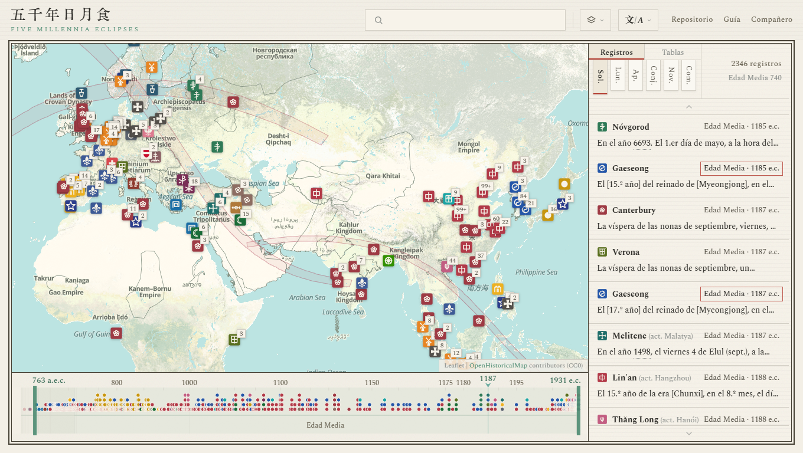
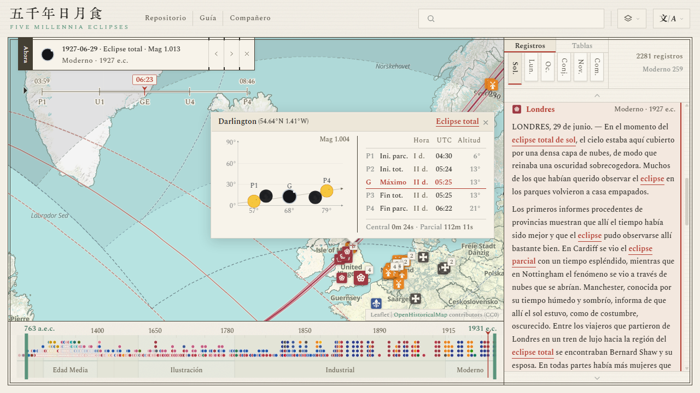

#  Five Millennia Eclipses

[简体中文](../zh-Hans/README.md) · [繁體中文](../zh-Hant/README.md) · [English](../en/README.md) · [Français](../fr/README.md) · **Español** · [Italiano](../it/README.md) · [日本語](../ja/README.md)

<p align="center">
  
</p>

**Sitio web**: <https://higashimado.github.io/FiveMillenniaEclipses/>

**Five Millennia Eclipses** es una base de datos abierta de registros astronómicos históricos, construida sobre las bibliotecas cartográficas Leaflet y MapLibre GL JS y sobre el formato de datos JSONL. Reúne más de diez mil registros de dominio público sobre fenómenos celestes, contrasta cada uno con el cálculo astronómico, anota su fecha, lugar, objeto y fuente, y los presenta todos sobre un mismo mapa histórico interactivo. De cada testimonio, el mapa muestra de un vistazo cuándo y dónde se observó el fenómeno, con qué nombre se lo llamó y qué era en realidad.

## Interfaz

La página principal consta de cuatro partes: la barra superior, el mapa, la línea de tiempo y el panel lateral. La línea de tiempo ocupa la parte inferior y el panel lateral, la derecha.

- **Barra superior**: el cuadro de búsqueda filtra los registros por texto original, traducción, nota, fuente, topónimo, fecha o civilización, y los menús cambian el mapa base y el idioma de la interfaz.
- **Mapa**: [OpenHistoricalMap](https://www.openhistoricalmap.org/) es el mapa base predeterminado, y sus elementos cambian según la época mostrada. Unos sellos señalan la civilización y el lugar de observación de cada registro.
- **Línea de tiempo**: una cronología con efecto de ojo de pez y foco ajustable, con marcas de años y límites de los grandes periodos. Unos puntos indican el momento en que se observó cada registro.
- **Panel lateral**: la vista Registros enumera los testimonios de fenómenos y la vista Tablas, los eventos astronómicos. Las pestañas de la parte superior del panel alternan entre tipos de fenómeno.

Al pulsar un sello del mapa o una entrada de la lista se abre el **detalle del evento**. En este modo:

- El mapa muestra las curvas de contacto del cono de sombra y la zona desde la que el evento fue visible, junto con la ubicación de todos los registros del mismo evento.
- La cartela reúne los datos principales del evento y su día en el ciclo sexagenario, y el dial situado debajo reproduce hora a hora la proyección del cono de sombra.
- Al pulsar cualquier punto del mapa se abre una ventana emergente con el esquema del eclipse y la tabla de contactos calculados para ese lugar.

<p align="center">
  
</p>

## Registros

El corpus reúne hoy 13 156 registros de fenómenos celestes, y su traducción al español suma casi 580 000 palabras. Proceden de 387 fuentes en 23 lenguas, entre ellas el chino clásico, el neerlandés, el francés, el inglés, el latín, el árabe y el griego. Los textos se han tomado de más de 20 bibliotecas digitales, como [Wikisource](https://wikisource.org/), [Delpher](https://www.delpher.nl/), [Gallica](https://gallica.bnf.fr/), [Internet Archive](https://archive.org/), [Chronicling America](https://chroniclingamerica.loc.gov/), la [Taiwan History Digital Library](http://thdl.ntu.edu.tw/), los [Monumenta Germaniae Historica (dMGH)](https://www.dmgh.de/) y [NASA ADS](https://ui.adsabs.harvard.edu/). Todos los textos citados son de dominio público.

### Géneros

Según su propósito y su forma, los registros se agrupan en cuatro grandes clases, «Anales», «Prensa», «Escritos científicos» y «Misceláneas», que a su vez se dividen en 22 subgéneros. El subgénero consta en el campo `genre` de [`sources.json`](../data/records/sources.json). Las clases difieren en estilo, tema, extensión y grado de detalle; la lista completa de fuentes está en [`SOURCES.md`](../SOURCES.md).

| Clase | Subgéneros | Fuentes | Registros | % de registros | Palabras en español | % de palabras | Periodo |
|---|---:|---:|---:|---:|---:|---:|---|
| Anales | 6 | 103 | 11 949 | 90,8 % | 323 936 | 56,1 % | 720 a. C. – 1911 |
| Prensa | 6 | 186 | 1003 | 7,6 % | 222 703 | 38,6 % | 1834 – 1941 |
| Escritos científicos | 3 | 57 | 57 | 0,4 % | 19 202 | 3,3 % | 1715 – 1923 |
| Misceláneas | 7 | 45 | 147 | 1,1 % | 11 787 | 2,0 % | 2137 a. C. – 1842 |
| **Total** | **22** | **387** | **13 156** | | **577 628** | | **2137 a. C. – 1941** |

Los **Anales** son sobre todo las historias oficiales de China, Japón, Corea y Vietnam, a las que se suman crónicas de Asia occidental y de Europa. Sus asientos forman series ininterrumpidas, están clasificados de manera sistemática y siguen un formato fijo; un ejemplo típico es el [Tratado de Astronomía de la *Historia de Song*](https://zh.wikisource.org/wiki/%E5%AE%8B%E5%8F%B2/%E5%8D%B7053). La **Prensa** pertenece a la época moderna y procede de muchas manos y de puntos de vista muy diversos, desde escenas callejeras llenas de vida hasta editoriales y artículos de opinión que leen el cielo como comentario de la actualidad. Los **Escritos científicos** son obra de astrónomos y otros eruditos y entran en gran detalle; el más trascendental es el de las observaciones del eclipse de 1919 que confirmaron la relatividad general, [*The Expedition to Sobral*](https://archive.org/details/philtrans06337895). Las **Misceláneas** abarcan clásicos, obras históricas, poemas, diarios, cartas y tablillas de arcilla, como el verso del *Clásico de la poesía* «El sol fue eclipsado, presagio de gran desdicha». Todos los testimonios más antiguos pertenecen a esta clase, aunque las fechas y los lugares que se les asignan son a menudo discutidos.

### Estructura

Los registros se guardan en formato JSONL en [`data/records/`](../data/records/), agrupados por fenómeno y civilización. Cada uno contiene el texto original, sus traducciones y una nota, además de anotaciones de fecha, lugar, civilización, fuente, fiabilidad y otros datos. En el mismo directorio, [`manifest.json`](../data/records/manifest.json) contiene la lista de archivos y el número de entradas; [`sources.json`](../data/records/sources.json), los títulos, autores, tomos, páginas y demás datos bibliográficos; y [`visibility.json`](../data/records/visibility.json), la visibilidad de cada evento, obtenida al contrastar lo que describe el registro con el cálculo astronómico.

| Archivo | Contenido | Usado por |
|---|---|---|
| [`data/records/README.md`](../data/records/README.md) | Descripción del formato | — |
| [`data/records/schema.json`](../data/records/schema.json) | Definición de campos | — |
| [`data/records/manifest.json`](../data/records/manifest.json) | Inventario de archivos | [`js/atlas.js`](../js/atlas.js) |
| [`data/records/sources.json`](../data/records/sources.json) | Catálogo de fuentes | [`js/atlas.js`](../js/atlas.js) |
| [`data/records/visibility.json`](../data/records/visibility.json) | Visibilidad | [`js/atlas.js`](../js/atlas.js) |
| [`data/records/`](../data/records/) `<fenómeno>/<civilización>.jsonl` | Los registros | [`js/atlas.js`](../js/atlas.js) |

`<fenómeno>` toma uno de los valores `solar`, `lunar`, `appulse`, `conjunction`, `guest` y `comet`, que corresponden a las seis pestañas del panel lateral. `<civilización>` toma uno de 33 valores, por ejemplo `chinese`; véase [`civilizations.json`](../data/concordance/civilizations.json).

## Tablas

Las tablas de eventos astronómicos abarcan los años −3000 a 1999 según la [numeración astronómica de años](https://es.wikipedia.org/wiki/Numeración_de_años_astronómica) y comprenden 11 871 eclipses de Sol y 12 031 eclipses de Luna. Los elementos besselianos de los eclipses de Sol, así como los números de saros y los valores de gamma de los eclipses de Luna, proceden del [*Five Millennium Canon* de eclipses de Sol y de Luna (5MCSE / 5MCLE)](https://eclipse.gsfc.nasa.gov/) de la NASA y F. Espenak. Las curvas de contacto se calculan con las herramientas geométricas de [SubstellarAtlas](https://github.com/Higashimado/SubstellarAtlas). Estos cánones empiezan en el 2000 a. C.; para los años anteriores, el proyecto obtiene sus propios elementos a partir de las efemérides [JPL DE441](https://ssd.jpl.nasa.gov/planets/eph_export.html), y la desviación típica de las longitudes resultantes oscila entre 4,48° y 7,30°.

| Archivo | Contenido | Usado por | Entradas | Tamaño |
|---|---|---|---:|---:|
| [`data/eclipses/README.md`](../data/eclipses/README.md) | Descripción del formato | — | | |
| [`data/eclipses/solar.json`](../data/eclipses/solar.json) | Índice de eclipses de Sol | [`js/eclipse-loader.js`](../js/eclipse-loader.js) | 11 871 | 9,7 MB |
| [`data/eclipses/lunar.json`](../data/eclipses/lunar.json) | Índice de eclipses de Luna | [`js/eclipse-loader.js`](../js/eclipse-loader.js) | 12 031 | 9,7 MB |
| [`data/eclipses/events/`](../data/eclipses/events/) `<fecha>.json` | Curvas de contacto y polinomios besselianos | [`js/eclipse.js`](../js/eclipse.js) | 11 871 | 386 MB |
| [`data/eclipses/bessel-5mcse.json`](../data/eclipses/bessel-5mcse.json) | Elementos besselianos del 5MCSE | — | 9506 | 5,8 MB |
| [`data/eclipses/bessel-ancient.json`](../data/eclipses/bessel-ancient.json) | Elementos besselianos calculados a partir de DE441 | — | 2365 | 2,1 MB |

`<fecha>` es una fecha astronómica tal como la define la norma [ISO 8601](https://web.archive.org/web/20171019211402/https://www.loc.gov/standards/datetime/ISO_DIS%208601-1.pdf), por ejemplo `-000762-06-07` o `1931-10-11`.

## Concordancias

Las tablas de concordancia unifican los metadatos de los objetos que las fuentes llaman por nombres distintos, como Yinghuo (荧惑) para Marte entre los astros o Yingtian (应天) para Nankín entre los lugares. Sirven de referencia para los campos correspondientes de los registros y de las tablas. Por ejemplo, [`gazetteer.json`](../data/concordance/gazetteer.json) contiene los nombres y coordenadas de los lugares de observación; [`xingguan.json`](../data/concordance/xingguan.json), los nombres, la extensión y el trazado de los asterismos chinos; y [`eras.json`](../data/concordance/eras.json), las eras china, japonesa, vietnamita y de los Xia Occidentales con su dinastía y el año astronómico correspondiente. Un mismo objeto puede tener abreviaturas y alias, o llevar un nombre concreto durante un periodo determinado; el campo `_meta` al principio de cada archivo define cómo se anotan.

| Archivo | Contenido | Usado por | Entradas |
|---|---|---|---:|
| [`data/concordance/README.md`](../data/concordance/README.md) | Descripción del formato | — | |
| [`data/concordance/gazetteer.json`](../data/concordance/gazetteer.json) | Lugares | [`js/atlas.js`](../js/atlas.js), [`js/place-name.js`](../js/place-name.js) | 565 |
| [`data/concordance/regions.json`](../data/concordance/regions.json) | Regiones | [`js/atlas.js`](../js/atlas.js), [`js/place-name.js`](../js/place-name.js) | 124 |
| [`data/concordance/civilizations.json`](../data/concordance/civilizations.json) | Civilizaciones | [`js/atlas.js`](../js/atlas.js), [`js/seal.js`](../js/seal.js) | 33 |
| [`data/concordance/organizations.json`](../data/concordance/organizations.json) | Nombres de instituciones | — | 52 |
| [`data/concordance/xingguan.json`](../data/concordance/xingguan.json) | Nombres chinos de estrellas | — | 407 |
| [`data/concordance/eras.json`](../data/concordance/eras.json) | Eras | [`js/atlas.js`](../js/atlas.js) | 830 |

## Ejecución

La parte visible del sitio es estática y no requiere compilación. La vista previa local necesita [Node.js](https://nodejs.org/). Tras clonar el repositorio, basta ejecutar en su raíz:

```bash
npm start
```

Después se abre <http://localhost:8002> en un navegador y se comprueba que el sitio se muestra correctamente.

## Directorios

- [`index.html`](../index.html), [`js/`](../js/), [`css/`](../css/): las páginas del sitio
- [`vendor/`](../vendor/): bibliotecas de terceros
- [`data/`](../data/): registros, tablas, concordancias y traducciones de la interfaz; convenciones en [`data/README.md`](../data/README.md)
- [`licenses/`](../licenses/): textos completos de las licencias
- [`serve.mjs`](../serve.mjs): servidor de vista previa local

## Créditos y licencia

El código propio del proyecto se publica bajo la [**GNU General Public License v3.0**](../LICENSE). [`data/records/`](../data/records/), [`data/eclipses/`](../data/eclipses/) y [`data/concordance/`](../data/concordance/) se publican bajo [**CC-BY-SA 4.0**](../licenses/data/CC-BY-SA-4.0.txt). El código, los datos y las tipografías de terceros conservan sus propias licencias; las atribuciones completas figuran en [`ATTRIBUTION.md`](../ATTRIBUTION.md).

| Uso | Componente (versión) | Autor o fuente | Licencia |
|---|---|---|---|
| Geometría de la sombra | [SubstellarAtlas](https://github.com/Higashimado/SubstellarAtlas) | Higashimado | GPL-3.0 |
| Motor cartográfico | [Leaflet](https://leafletjs.com/) 1.9.4 | Volodymyr Agafonkin | BSD-2-Clause |
| Renderizado vectorial | [MapLibre GL JS](https://maplibre.org/) 5.24.0 | MapLibre | BSD-3-Clause |
| Puente entre capas | [maplibre-gl-leaflet](https://github.com/maplibre/maplibre-gl-leaflet) 0.1.3 | MapLibre | ISC |
| Filtrado por fecha | [maplibre-gl-dates](https://github.com/OpenHistoricalMap/maplibre-gl-dates) 1.3.0 | OpenHistoricalMap | CC0-1.0 |
| Cálculo astronómico | [Astronomy Engine](https://github.com/cosinekitty/astronomy) 2.1.19 | Don Cross | MIT |
| Cánones de eclipses | [5MCSE / 5MCLE](https://eclipse.gsfc.nasa.gov/) | Fred Espenak (NASA GSFC) | Dominio público; se solicita atribución |
| Efemérides antiguas | [JPL DE441](https://ssd.jpl.nasa.gov/planets/eph_export.html) | JPL | Dominio público |
| Rotación terrestre | [Stephenson, Morrison & Hohenkerk 2016](https://doi.org/10.1098/rspa.2016.0404) | Royal Society | CC BY 4.0 |
| Textos de origen | [Wikisource](https://wikisource.org/) | Colaboradores de Wikisource | CC-BY-SA 4.0 |
| Textos de origen | [Delpher](https://www.delpher.nl/), [Gallica](https://gallica.bnf.fr/), [Internet Archive](https://archive.org/), [Chronicling America](https://chroniclingamerica.loc.gov/), etc. | Instituciones depositarias | Dominio público |
| Mapa base histórico | [OpenHistoricalMap](https://www.openhistoricalmap.org/) | Comunidad OHM | Datos CC0 |
| Mapa base moderno | [CARTO](https://carto.com/) Positron · Voyager | CARTO | © CARTO |
| Mapa base moderno | [OpenStreetMap](https://www.openstreetmap.org/) capa estándar | Colaboradores de OSM | ODbL |
| Mapa base de relieve | [Esri World Shaded Relief](https://www.esri.com/) | Esri / USGS | © Esri |
| Datos del mapa base | [OpenStreetMap](https://www.openstreetmap.org/copyright) | Colaboradores de OSM | ODbL |
| Tipografía CJK | [Source Han Serif](https://github.com/adobe-fonts/source-han-serif) | Adobe | OFL |
| Tipografía latina | [Spectral](https://fonts.google.com/specimen/Spectral) | Production Type | OFL |
| Tipografías con serifa | [Noto Serif](https://fonts.google.com/noto) · Naskh Arabic · Serif Armenian · Serif Hebrew | Google | OFL |
| Tipografía de títulos | [KingHwaOldSong](https://fonts.zeoseven.com/) | ZeoSeven Fonts | Véase el [archivo de licencia](../licenses/fonts/KingHwaOldSong-LICENSE.md) |

Con tantos registros, es inevitable que haya algunas omisiones y errores. Las adiciones, correcciones y objeciones respaldadas con pruebas son bienvenidos en las [issues](https://github.com/Higashimado/FiveMillenniaEclipses/issues).
