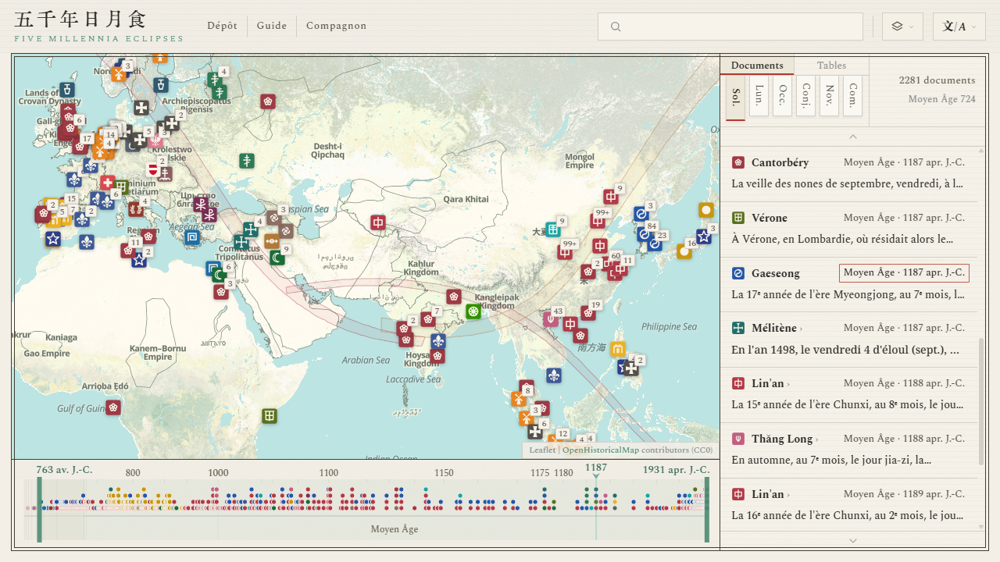
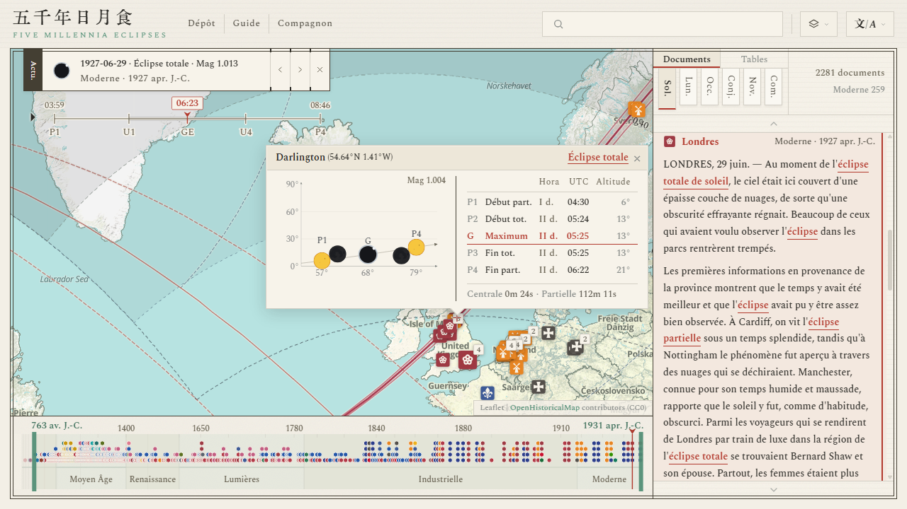

#  Five Millennia Eclipses

[简体中文](../zh-Hans/README.md) · [繁體中文](../zh-Hant/README.md) · [English](../en/README.md) · **Français** · [Español](../es/README.md) · [Italiano](../it/README.md) · [日本語](../ja/README.md)

<p align="center">
  
</p>

**Site** : <https://higashimado.github.io/FiveMillenniaEclipses/>

**Five Millennia Eclipses** est une base de données ouverte d'observations astronomiques anciennes, construite sur les bibliothèques cartographiques Leaflet et MapLibre GL JS et sur le format de données JSONL. Elle réunit plus de dix mille documents du domaine public relatant des phénomènes célestes. Chacun est confronté au calcul astronomique et annoté de sa date, de son lieu, de son objet et de sa source, puis l'ensemble est présenté sur une même carte historique interactive. Pour chaque témoignage, la carte montre d'un coup d'œil quand et où le phénomène a été observé, sous quel nom on le désignait et ce qu'il était réellement.

## Interface

La page principale se compose de quatre parties : la barre supérieure, la carte, la frise et le panneau latéral. La frise occupe le bas de la page, le panneau latéral la droite.

- **Barre supérieure** : le champ de recherche filtre les documents par texte original, traduction, note, source, nom de lieu, date ou civilisation ; les menus changent le fond de carte et la langue de l'interface.
- **Carte** : [OpenHistoricalMap](https://www.openhistoricalmap.org/) sert de fond par défaut, et ses éléments évoluent avec l'époque affichée. Des sceaux indiquent la civilisation et le lieu d'observation de chaque document.
- **Frise** : une chronologie à effet fish-eye, au foyer réglable, graduée en années et marquée des limites des grandes périodes. Des points y situent la date d'observation de chaque document.
- **Panneau latéral** : la vue Documents recense les observations et la vue Tables les événements astronomiques. Des onglets en haut du panneau font passer d'un type de phénomène à l'autre.

Un clic sur un sceau de la carte ou sur une entrée de la liste ouvre le **détail de l'événement**. Dans ce mode :

- La carte trace les courbes de contact du cône d'ombre et la zone de visibilité de l'événement, avec l'emplacement de tous les documents qui s'y rapportent.
- Le cartouche donne les chiffres clés de l'événement et son jour dans le cycle sexagésimal ; la molette placée dessous déroule heure par heure la projection du cône d'ombre.
- Un clic en un point quelconque de la carte ouvre une fenêtre contextuelle avec le schéma de l'éclipse et le tableau des contacts calculés pour ce lieu.

<p align="center">
  
</p>

## Documents

Le corpus compte aujourd'hui 13 159 documents sur des phénomènes célestes, dont la traduction française totalise environ 480 000 mots. Ils proviennent de 381 sources en 23 langues, parmi lesquelles le chinois classique, le néerlandais, le français, l'anglais, le latin, l'arabe et le grec. Les textes ont été relevés dans plus de 20 bibliothèques numériques, dont [Wikisource](https://wikisource.org/), [Delpher](https://www.delpher.nl/), [Gallica](https://gallica.bnf.fr/), [Internet Archive](https://archive.org/), [Chronicling America](https://chroniclingamerica.loc.gov/), la [Taiwan History Digital Library](http://thdl.ntu.edu.tw/), les [Monumenta Germaniae Historica (dMGH)](https://www.dmgh.de/) et [NASA ADS](https://ui.adsabs.harvard.edu/). Tous les textes cités appartiennent au domaine public.

### Genres

Selon leur but et leur forme, les documents se répartissent en quatre grandes classes, « Annales », « Presse », « Écrits savants » et « Mélanges », elles-mêmes subdivisées en 19 sous-genres. Le sous-genre est indiqué dans le champ `genre` de [`sources.json`](../data/records/sources.json). Les classes diffèrent par le style, le sujet, la longueur et le degré de détail ; la liste complète des sources figure dans [`SOURCES.md`](../SOURCES.md).

| Classe | Sous-genres | Sources | Documents | Part des documents | Mots en français | Part des mots | Période |
|---|---:|---:|---:|---:|---:|---:|---|
| Annales | 6 | 92 | 12 012 | 91,3 % | 240 106 | 49,7 % | 720 av. J.-C. – 1911 |
| Presse | 6 | 186 | 1 000 | 7,6 % | 218 256 | 45,2 % | 1834 – 1941 |
| Écrits savants | 3 | 55 | 55 | 0,4 % | 17 914 | 3,7 % | 1715 – 1923 |
| Mélanges | 4 | 50 | 92 | 0,7 % | 6 990 | 1,4 % | 2137 av. J.-C. – 1842 |
| **Total** | **19** | **381** | **13 159** | | **483 266** | | **2137 av. J.-C. – 1941** |

Les **Annales** sont avant tout les histoires officielles de la Chine, du Japon, de la Corée et du Viêt Nam, complétées par des chroniques d'Asie occidentale et d'Europe. Leurs relevés forment des séries ininterrompues, classées avec méthode et de forme régulière, à l'exemple du [Traité d'astronomie de l'*Histoire des Song*](https://zh.wikisource.org/wiki/%E5%AE%8B%E5%8F%B2/%E5%8D%B7053). La **Presse** appartient à l'époque moderne ; elle émane de multiples plumes et de points de vue très divers, des scènes de rue pleines de vie aux éditoriaux et aux chroniques qui font du ciel un commentaire sur l'actualité. Les **Écrits savants** sont l'œuvre d'astronomes et d'autres savants et entrent dans un grand détail ; le plus marquant est le recueil des observations de l'éclipse de 1919 qui ont confirmé la relativité générale, [*The Expedition to Sobral*](https://archive.org/details/philtrans06337895). Les **Mélanges** rassemblent classiques, ouvrages d'histoire, poèmes, journaux intimes, lettres et tablettes d'argile, comme ce vers du *Classique des vers* : « Le soleil s'est éclipsé, présage des plus funestes ». Tous les témoignages les plus anciens relèvent de cette classe, mais les dates et les lieux qu'on leur attribue sont souvent discutés.

### Structure

Les documents sont enregistrés au format JSONL dans [`data/records/`](../data/records/), répartis par phénomène et par civilisation. Chacun contient le texte original, ses traductions et une note, avec les annotations de date, de lieu, de civilisation, de source, de fiabilité, etc. Dans le même répertoire, [`manifest.json`](../data/records/manifest.json) contient la liste des fichiers et le nombre d'entrées, [`sources.json`](../data/records/sources.json) les titres, auteurs, volumes, pages et autres renseignements bibliographiques, et [`visibility.json`](../data/records/visibility.json) la visibilité de chaque événement, établie en confrontant la description du document au calcul astronomique.

| Fichier | Contenu | Utilisé par |
|---|---|---|
| [`data/records/README.md`](../data/records/README.md) | Description du format | — |
| [`data/records/schema.json`](../data/records/schema.json) | Définition des champs | — |
| [`data/records/manifest.json`](../data/records/manifest.json) | Inventaire des fichiers | [`js/atlas.js`](../js/atlas.js) |
| [`data/records/sources.json`](../data/records/sources.json) | Catalogue des sources | [`js/atlas.js`](../js/atlas.js) |
| [`data/records/visibility.json`](../data/records/visibility.json) | Visibilité | [`js/atlas.js`](../js/atlas.js) |
| [`data/records/`](../data/records/) `<phénomène>/<civilisation>.jsonl` | Les documents | [`js/atlas.js`](../js/atlas.js) |

`<phénomène>` prend l'une des valeurs `solar`, `lunar`, `occultation`, `conjunction`, `guest` et `comet`, qui correspondent aux six onglets du panneau latéral. `<civilisation>` prend l'une de 33 valeurs, par exemple `chinese` ; voir [`civilizations.json`](../data/concordance/civilizations.json).

## Tables

Les tables d'événements astronomiques couvrent les années −3000 à 1999 en [numérotation astronomique des années](https://en.wikipedia.org/wiki/Astronomical_year_numbering) et comptent 11 871 éclipses de Soleil et 12 031 éclipses de Lune. Les éléments de Bessel des éclipses de Soleil, ainsi que les numéros de saros et les valeurs de gamma des éclipses de Lune, sont repris du [*Five Millennium Canon* des éclipses de Soleil et de Lune (5MCSE / 5MCLE)](https://eclipse.gsfc.nasa.gov/) de la NASA et de F. Espenak. Les courbes de contact sont calculées avec les outils géométriques de [SubstellarAtlas](https://github.com/Higashimado/SubstellarAtlas). Ces canons commencent en 2000 av. J.-C. ; pour les années antérieures, le projet établit ses propres éléments à partir des éphémérides [JPL DE441](https://ssd.jpl.nasa.gov/planets/eph_export.html), et l'écart type des longitudes obtenues va de 4,48° à 7,30°.

| Fichier | Contenu | Utilisé par | Entrées | Taille |
|---|---|---|---:|---:|
| [`data/eclipses/README.md`](../data/eclipses/README.md) | Description du format | — | | |
| [`data/eclipses/solar.json`](../data/eclipses/solar.json) | Index des éclipses de Soleil | [`js/eclipse-loader.js`](../js/eclipse-loader.js) | 11 871 | 9,7 Mo |
| [`data/eclipses/lunar.json`](../data/eclipses/lunar.json) | Index des éclipses de Lune | [`js/eclipse-loader.js`](../js/eclipse-loader.js) | 12 031 | 9,7 Mo |
| [`data/eclipses/events/`](../data/eclipses/events/) `<date>.json` | Courbes de contact et polynômes de Bessel | [`js/eclipse.js`](../js/eclipse.js) | 11 871 | 386 Mo |
| [`data/eclipses/bessel-5mcse.json`](../data/eclipses/bessel-5mcse.json) | Éléments de Bessel du 5MCSE | — | 9 506 | 5,8 Mo |
| [`data/eclipses/bessel-ancient.json`](../data/eclipses/bessel-ancient.json) | Éléments de Bessel calculés d'après DE441 | — | 2 365 | 2,1 Mo |

`<date>` est une date astronomique au sens de la norme [ISO 8601](https://web.archive.org/web/20171019211402/https://www.loc.gov/standards/datetime/ISO_DIS%208601-1.pdf), par exemple `-000762-06-07` ou `1931-10-11`.

## Concordances

Les tables de concordance unifient les métadonnées des objets que les sources désignent sous des noms différents : Yinghuo (荧惑) pour Mars parmi les astres, Yingtian (应天) pour Nankin parmi les lieux. Elles font autorité pour les champs correspondants des documents et des tables. Ainsi, [`gazetteer.json`](../data/concordance/gazetteer.json) contient les noms et les coordonnées des lieux d'observation, [`xingguan.json`](../data/concordance/xingguan.json) les noms, l'étendue et le tracé des astérismes chinois, et [`nianhao.json`](../data/concordance/nianhao.json) les ères chinoises avec leur dynastie et l'année astronomique correspondante. Un même objet peut avoir des abréviations et des alias, ou porter un nom particulier sur une période donnée ; le champ `_meta` en tête de chaque fichier définit la manière de les noter.

| Fichier | Contenu | Utilisé par | Entrées |
|---|---|---|---:|
| [`data/concordance/README.md`](../data/concordance/README.md) | Description du format | — | |
| [`data/concordance/gazetteer.json`](../data/concordance/gazetteer.json) | Lieux | [`js/atlas.js`](../js/atlas.js), [`js/place-name.js`](../js/place-name.js) | 546 |
| [`data/concordance/regions.json`](../data/concordance/regions.json) | Régions | [`js/atlas.js`](../js/atlas.js), [`js/place-name.js`](../js/place-name.js) | 124 |
| [`data/concordance/civilizations.json`](../data/concordance/civilizations.json) | Civilisations | [`js/atlas.js`](../js/atlas.js), [`js/seal.js`](../js/seal.js) | 33 |
| [`data/concordance/organizations.json`](../data/concordance/organizations.json) | Noms d'institutions | — | 52 |
| [`data/concordance/xingguan.json`](../data/concordance/xingguan.json) | Noms d'étoiles chinois | — | 413 |
| [`data/concordance/nianhao.json`](../data/concordance/nianhao.json) | Ères chinoises | [`js/atlas.js`](../js/atlas.js) | 330 |
| [`data/concordance/nengo.json`](../data/concordance/nengo.json) | Ères japonaises | [`js/atlas.js`](../js/atlas.js) | 241 |

## Lancement

Le frontal est un site statique sans étape de compilation. L'aperçu local nécessite [Node.js](https://nodejs.org/). Après avoir cloné le dépôt, exécuter à sa racine :

```bash
npm start
```

Ouvrir ensuite <http://localhost:8002> dans un navigateur et vérifier que le site s'affiche correctement.

## Arborescence

- [`index.html`](../index.html), [`js/`](../js/), [`css/`](../css/) : les pages du site
- [`vendor/`](../vendor/) : bibliothèques tierces
- [`data/`](../data/) : documents, tables, concordances et traductions de l'interface ; conventions dans [`data/README.md`](../data/README.md)
- [`licenses/`](../licenses/) : textes intégraux des licences
- [`serve.mjs`](../serve.mjs) : serveur d'aperçu local

## Crédits et licence

Le code propre au projet est publié sous [**GNU General Public License v3.0**](../LICENSE). [`data/records/`](../data/records/), [`data/eclipses/`](../data/eclipses/) et [`data/concordance/`](../data/concordance/) sont publiés sous [**CC-BY-SA 4.0**](../licenses/data/CC-BY-SA-4.0.txt). Le code, les données et les polices de tiers restent soumis à leurs propres licences ; les attributions complètes figurent dans [`ATTRIBUTION.md`](../ATTRIBUTION.md).

| Usage | Composant (version) | Auteur ou source | Licence |
|---|---|---|---|
| Géométrie de l'ombre | [SubstellarAtlas](https://github.com/Higashimado/SubstellarAtlas) | Higashimado | GPL-3.0 |
| Moteur cartographique | [Leaflet](https://leafletjs.com/) 1.9.4 | Volodymyr Agafonkin | BSD-2-Clause |
| Rendu vectoriel | [MapLibre GL JS](https://maplibre.org/) 5.24.0 | MapLibre | BSD-3-Clause |
| Pont entre couches | [maplibre-gl-leaflet](https://github.com/maplibre/maplibre-gl-leaflet) 0.1.3 | MapLibre | ISC |
| Filtrage par date | [maplibre-gl-dates](https://github.com/OpenHistoricalMap/maplibre-gl-dates) 1.3.0 | OpenHistoricalMap | CC0-1.0 |
| Calcul astronomique | [Astronomy Engine](https://github.com/cosinekitty/astronomy) 2.1.19 | Don Cross | MIT |
| Canons des éclipses | [5MCSE / 5MCLE](https://eclipse.gsfc.nasa.gov/) | Fred Espenak (NASA GSFC) | Domaine public, attribution demandée |
| Éphémérides anciennes | [JPL DE441](https://ssd.jpl.nasa.gov/planets/eph_export.html) | JPL | Domaine public |
| Rotation terrestre | [Stephenson, Morrison & Hohenkerk 2016](https://doi.org/10.1098/rspa.2016.0404) | Royal Society | CC BY 4.0 |
| Textes sources | [Wikisource](https://wikisource.org/) | Contributeurs de Wikisource | CC-BY-SA 4.0 |
| Textes sources | [Delpher](https://www.delpher.nl/), [Gallica](https://gallica.bnf.fr/), [Internet Archive](https://archive.org/), [Chronicling America](https://chroniclingamerica.loc.gov/), etc. | Institutions détentrices | Domaine public |
| Fond historique | [OpenHistoricalMap](https://www.openhistoricalmap.org/) | Communauté OHM | Données CC0 |
| Fond moderne | [CARTO](https://carto.com/) Positron · Voyager | CARTO | © CARTO |
| Fond moderne | [OpenStreetMap](https://www.openstreetmap.org/) couche standard | Contributeurs d'OSM | ODbL |
| Fond en relief | [Esri World Shaded Relief](https://www.esri.com/) | Esri / USGS | © Esri |
| Données du fond | [OpenStreetMap](https://www.openstreetmap.org/copyright) | Contributeurs d'OSM | ODbL |
| Police CJK | [Source Han Serif](https://github.com/adobe-fonts/source-han-serif) | Adobe | OFL |
| Police latine | [Spectral](https://fonts.google.com/specimen/Spectral) | Production Type | OFL |
| Polices à empattements | [Noto Serif](https://fonts.google.com/noto) · Naskh Arabic · Serif Armenian · Serif Hebrew | Google | OFL |
| Police de titrage | [KingHwaOldSong](https://fonts.zeoseven.com/) | ZeoSeven Fonts | Voir le [fichier de licence](../licenses/fonts/KingHwaOldSong-LICENSE.md) |

Avec un corpus aussi vaste, quelques omissions et erreurs sont inévitables. Compléments, corrections et objections appuyées sur des preuves sont les bienvenus dans les [issues](https://github.com/Higashimado/FiveMillenniaEclipses/issues).
