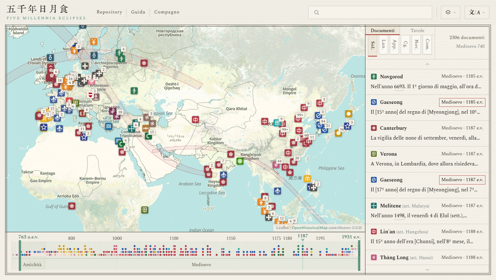
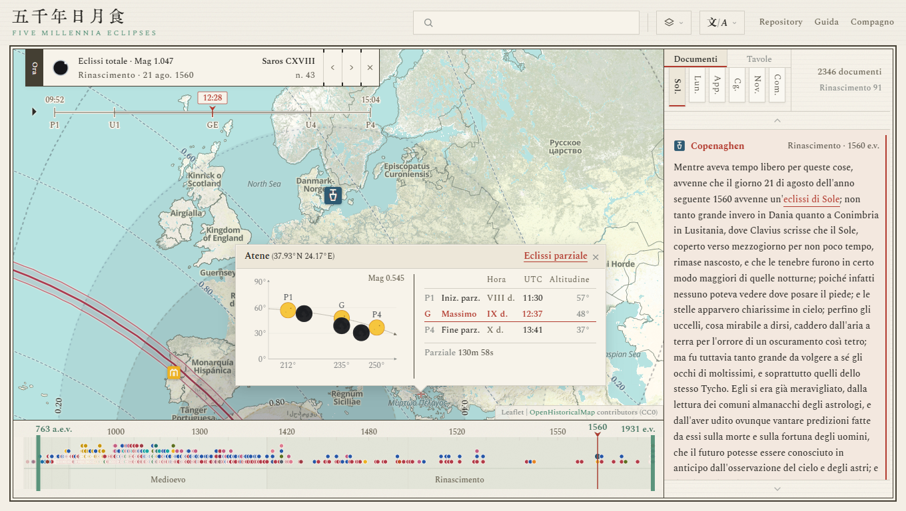
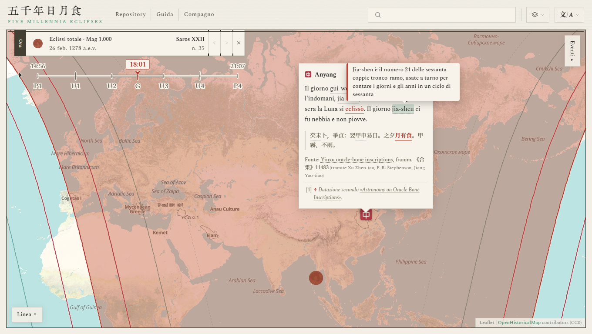
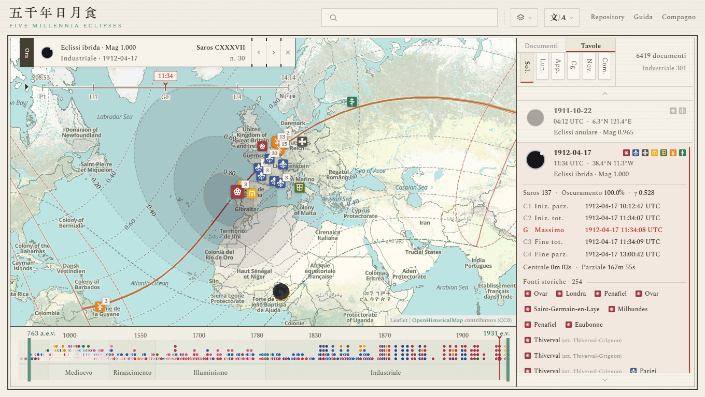

#  Five Millennia Eclipses

[简体中文](../zh-Hans/README.md) · [繁體中文](../zh-Hant/README.md) · [English](../en/README.md) · [Français](../fr/README.md) · [Español](../es/README.md) · **Italiano** · [日本語](../ja/README.md)

<p align="center">
  
</p>

**Sito**: <https://higashimado.github.io/FiveMillenniaEclipses/>

**Five Millennia Eclipses** è una banca dati aperta di documenti astronomici storici, costruita sulle librerie cartografiche Leaflet e MapLibre GL JS e sul formato di dati JSONL. Raccoglie oltre diecimila documenti di pubblico dominio su fenomeni celesti, confronta ciascuno con il calcolo astronomico, ne annota data, luogo, oggetto e fonte, e li presenta tutti su un'unica mappa storica interattiva. Per ogni testimonianza, la mappa mostra a colpo d'occhio quando e dove il fenomeno fu osservato, con quale nome lo si chiamava e che cosa fosse in realtà.

## Interfaccia

La pagina principale si compone di quattro parti: la barra superiore, la mappa, la linea del tempo e il pannello laterale. La linea del tempo corre lungo il margine inferiore, il pannello laterale occupa il lato destro.

- **Barra superiore**: la casella di ricerca cerca nel testo originale, nella traduzione, nelle note, nella fonte, nel toponimo, nella data, nella civiltà e in altri campi dei documenti, e i menu a destra cambiano la mappa di base e la lingua.
- **Mappa**: [OpenHistoricalMap](https://www.openhistoricalmap.org/) è la mappa di base predefinita, e i suoi elementi cambiano con l'epoca visualizzata. Dei sigilli sulla mappa indicano la civiltà e il luogo di osservazione di ciascun documento.
- **Linea del tempo**: una cronologia a occhio di pesce che dilata gli anni vicini al fuoco e comprime quelli lontani. Il fuoco è regolabile, e la linea porta le tacche degli anni e i confini dei grandi periodi. I punti segnano il momento in cui ciascun documento fu osservato.
- **Pannello laterale**: la vista Documenti elenca le testimonianze dei fenomeni e la vista Tavole gli eventi astronomici. Le schede in cima al pannello passano da un tipo di fenomeno all'altro, e il riquadro in alto a destra mostra il numero totale di voci.

Un clic su un sigillo della mappa o su una voce dell'elenco apre il **dettaglio dell'evento**. In questa modalità:

- La mappa mostra le curve di contatto del cono d'ombra e la zona da cui l'evento era visibile, insieme alla posizione di tutti i documenti relativi allo stesso evento.
- Il cartiglio riporta i dati essenziali dell'evento e il suo giorno nel ciclo sessagenario, e la ghiera sottostante riproduce ora per ora la proiezione del cono d'ombra.
- Un clic su un punto qualsiasi della mappa apre una finestra a comparsa con lo schema dell'eclissi e la tabella dei contatti calcolati per quel luogo.

<p align="center">
  
</p>

## Documenti

Il corpus conta oggi 13.195 documenti su fenomeni celesti, e la loro traduzione italiana raggiunge circa 550.000 parole. Provengono da 387 fonti in 23 lingue, tra cui il cinese classico, il neerlandese, il francese, l'inglese, il latino, l'arabo e il greco. I testi sono stati tratti da oltre 20 biblioteche digitali, tra cui [Wikisource](https://wikisource.org/), [Delpher](https://www.delpher.nl/), [Gallica](https://gallica.bnf.fr/), [Internet Archive](https://archive.org/), [Chronicling America](https://chroniclingamerica.loc.gov/), la [Taiwan History Digital Library](http://thdl.ntu.edu.tw/), i [Monumenta Germaniae Historica (dMGH)](https://www.dmgh.de/) e [NASA ADS](https://ui.adsabs.harvard.edu/). Tutti i testi citati sono di pubblico dominio.

### Generi

Per scopo e forma, i documenti si dividono in quattro grandi classi, «Annali», «Stampa», «Scritti scientifici» e «Miscellanea», a loro volta suddivise in 22 sottogeneri. Il sottogenere è registrato nel campo `genre` di [`sources.json`](../data/records/sources.json). Le classi differiscono per stile, argomento, lunghezza e grado di dettaglio; l'elenco completo delle fonti si trova in [`SOURCES.md`](../SOURCES.md).

| Classe | Sottogeneri | Fonti | Documenti | Quota di documenti | Parole in italiano | Quota di parole | Periodo |
|---|---:|---:|---:|---:|---:|---:|---|
| Annali | 6 | 103 | 11.948 | 90,5% | 301.099 | 54,3% | 720 a.C. – 1911 |
| Stampa | 6 | 186 | 1043 | 7,9% | 220.830 | 39,9% | 1834 – 1941 |
| Scritti scientifici | 3 | 57 | 57 | 0,4% | 20.497 | 3,7% | 1715 – 1923 |
| Miscellanea | 7 | 45 | 147 | 1,1% | 11.716 | 2,1% | 2137 a.C. – 1842 |
| **Totale** | **22** | **387** | **13.195** | | **554.142** | | **2137 a.C. – 1941** |

Gli **Annali** sono soprattutto le storie ufficiali di Cina, Giappone, Corea e Vietnam, affiancate da cronache dell'Asia occidentale e d'Europa. Le loro registrazioni formano serie ininterrotte, sono classificate in modo sistematico e seguono una forma costante; ne è un esempio tipico il [Trattato di astronomia della *Storia dei Song*](https://zh.wikisource.org/wiki/%E5%AE%8B%E5%8F%B2/%E5%8D%B7053). La **Stampa** appartiene all'età moderna e nasce da molte mani e da punti di vista assai diversi, da vivaci scene di vita cittadina a editoriali e articoli di commento che leggono il cielo come allegoria dell'attualità. Gli **Scritti scientifici** sono opera di astronomi e altri studiosi e scendono in grande dettaglio; il più importante è quello delle osservazioni dell'eclissi del 1919 che confermarono la relatività generale, [*The Expedition to Sobral*](https://archive.org/details/philtrans06337895). La **Miscellanea** comprende classici, opere storiche, poesie, diari, lettere e tavolette d'argilla, come il verso del *Classico delle poesie* «Il sole si è oscurato, presagio di grande sventura». Tutte le testimonianze più antiche appartengono a questa classe, benché le date e i luoghi loro attribuiti siano spesso controversi.

<p align="center">
  
</p>

### Struttura

I documenti sono conservati in formato JSONL in [`data/records/`](../data/records/), suddivisi per fenomeno e per civiltà. Ciascuno contiene il testo originale, le traduzioni e una nota, oltre alle annotazioni di data, luogo, civiltà, fonte, affidabilità e altro. Nella stessa cartella, [`manifest.json`](../data/records/manifest.json) contiene l'elenco dei file e il numero di voci, [`sources.json`](../data/records/sources.json) titoli, autori, volumi, pagine e altri dati bibliografici, e [`visibility.json`](../data/records/visibility.json) la visibilità di ciascun evento, ricavata confrontando la descrizione del documento con il calcolo astronomico.

| File | Contenuto | Usato da |
|---|---|---|
| [`data/records/README.md`](../data/records/README.md) | Descrizione del formato | — |
| [`data/records/schema.json`](../data/records/schema.json) | Definizione dei campi | — |
| [`data/records/manifest.json`](../data/records/manifest.json) | Inventario dei file | [`js/atlas.js`](../js/atlas.js) |
| [`data/records/sources.json`](../data/records/sources.json) | Catalogo delle fonti | [`js/atlas.js`](../js/atlas.js) |
| [`data/records/visibility.json`](../data/records/visibility.json) | Visibilità | [`js/atlas.js`](../js/atlas.js) |
| [`data/records/`](../data/records/) `<fenomeno>/<civiltà>.jsonl` | I documenti | [`js/atlas.js`](../js/atlas.js) |

`<fenomeno>` assume uno dei valori `solar`, `lunar`, `appulse`, `conjunction`, `guest` e `comet`, corrispondenti alle sei schede del pannello laterale. `<civiltà>` assume uno di 33 valori, per esempio `chinese`; si veda [`civilizations.json`](../data/concordance/civilizations.json).

## Tavole

Le tavole degli eventi astronomici coprono gli anni da −3000 a 1999 secondo la [numerazione astronomica degli anni](https://en.wikipedia.org/wiki/Astronomical_year_numbering) e comprendono 11.871 eclissi di Sole e 12.031 eclissi di Luna. Gli elementi besseliani delle eclissi di Sole, come pure i numeri di saros e i valori di gamma delle eclissi di Luna, sono ripresi dal [*Five Millennium Canon* delle eclissi di Sole e di Luna (5MCSE / 5MCLE)](https://eclipse.gsfc.nasa.gov/) della NASA e di F. Espenak. Le curve di contatto sono calcolate con gli strumenti geometrici di [SubstellarAtlas](https://github.com/Higashimado/SubstellarAtlas). Questi canoni iniziano dal 2000 a.C.; per gli anni precedenti il progetto ricava elementi propri dalle effemeridi [JPL DE441](https://ssd.jpl.nasa.gov/planets/eph_export.html), e la deviazione standard delle longitudini ottenute va da 4,48° a 7,30°.

| File | Contenuto | Usato da | Voci | Dimensione |
|---|---|---|---:|---:|
| [`data/eclipses/README.md`](../data/eclipses/README.md) | Descrizione del formato | — | | |
| [`data/eclipses/solar.json`](../data/eclipses/solar.json) | Indice delle eclissi di Sole | [`js/eclipse-loader.js`](../js/eclipse-loader.js) | 11.871 | 9,7 MB |
| [`data/eclipses/lunar.json`](../data/eclipses/lunar.json) | Indice delle eclissi di Luna | [`js/eclipse-loader.js`](../js/eclipse-loader.js) | 12.031 | 9,7 MB |
| [`data/eclipses/events/`](../data/eclipses/events/) `<data>.json` | Curve di contatto e polinomi besseliani | [`js/eclipse.js`](../js/eclipse.js) | 11.871 | 386 MB |
| [`data/eclipses/bessel-5mcse.json`](../data/eclipses/bessel-5mcse.json) | Elementi besseliani del 5MCSE | — | 9506 | 5,8 MB |
| [`data/eclipses/bessel-ancient.json`](../data/eclipses/bessel-ancient.json) | Elementi besseliani calcolati da DE441 | — | 2365 | 2,1 MB |

`<data>` è una data astronomica secondo la norma [ISO 8601](https://web.archive.org/web/20171019211402/https://www.loc.gov/standards/datetime/ISO_DIS%208601-1.pdf), per esempio `-000762-06-07` o `1931-10-11`.

<p align="center">
  
</p>

## Concordanze

Le tavole di concordanza unificano i metadati degli oggetti che le fonti chiamano con nomi diversi, come Yinghuo (荧惑) per Marte tra gli astri o Yingtian (应天) per Nanchino tra i luoghi. Fanno fede per i campi corrispondenti dei documenti e delle tavole. Per esempio, [`gazetteer.json`](../data/concordance/gazetteer.json) contiene i nomi e le coordinate dei luoghi di osservazione, [`xingguan.json`](../data/concordance/xingguan.json) i nomi, l'estensione e il tracciato degli asterismi cinesi, e [`eras.json`](../data/concordance/eras.json) le ere cinese, coreana, giapponese, vietnamita e dei Xia Occidentali con la loro dinastia e l'anno astronomico corrispondente. Altre tavole riguardano persone, calendari, termini e altro; il campo `_meta` in testa a ciascun file ne riporta le definizioni.

| File | Contenuto | Usato da | Voci |
|---|---|---|---:|
| [`data/concordance/README.md`](../data/concordance/README.md) | Descrizione del formato | — | |
| [`data/concordance/gazetteer.json`](../data/concordance/gazetteer.json) | Luoghi | [`js/atlas.js`](../js/atlas.js), [`js/place-name.js`](../js/place-name.js) | 573 |
| [`data/concordance/regions.json`](../data/concordance/regions.json) | Regioni | [`js/atlas.js`](../js/atlas.js), [`js/place-name.js`](../js/place-name.js) | 124 |
| [`data/concordance/civilizations.json`](../data/concordance/civilizations.json) | Civiltà | [`js/atlas.js`](../js/atlas.js), [`js/seal.js`](../js/seal.js) | 33 |
| [`data/concordance/persons.json`](../data/concordance/persons.json) | Nomi di persone | [`js/atlas.js`](../js/atlas.js) | 76 |
| [`data/concordance/organizations.json`](../data/concordance/organizations.json) | Nomi di istituzioni | — | 52 |
| [`data/concordance/terms.json`](../data/concordance/terms.json) | Termini | [`js/atlas.js`](../js/atlas.js) | 86 |
| [`data/concordance/calendars.json`](../data/concordance/calendars.json) | Calendari | [`js/atlas.js`](../js/atlas.js) | 15 |
| [`data/concordance/eras.json`](../data/concordance/eras.json) | Ere | [`js/atlas.js`](../js/atlas.js), [`js/supplied.js`](../js/supplied.js) | 830 |
| [`data/concordance/xingguan.json`](../data/concordance/xingguan.json) | Nomi cinesi delle stelle | [`js/atlas.js`](../js/atlas.js) | 412 |
| [`data/concordance/bodies.json`](../data/concordance/bodies.json) | Nomi degli astri | [`js/atlas.js`](../js/atlas.js), [`js/supplied.js`](../js/supplied.js) | 8 |

Le tavole lette da [`js/atlas.js`](../js/atlas.js) servono a disegnare la pagina: sigilli, toponimi, finestre a comparsa, note e così via.

## Avvio

Il sito è statico e non prevede alcuna fase di compilazione. L'anteprima locale richiede [Node.js](https://nodejs.org/). Dopo aver clonato il repository, basta eseguire nella sua radice:

```bash
npm start
```

Si apre poi <http://localhost:8002> in un browser e si verifica che il sito venga visualizzato correttamente.

## Cartelle

- [`index.html`](../index.html), [`js/`](../js/), [`css/`](../css/): le pagine del sito
- [`vendor/`](../vendor/): librerie di terze parti
- [`data/`](../data/): documenti, tavole, concordanze e traduzioni dell'interfaccia; convenzioni in [`data/README.md`](../data/README.md)
- [`licenses/`](../licenses/): testi integrali delle licenze
- [`serve.mjs`](../serve.mjs): server per l'anteprima locale

## Crediti e licenza

Il codice proprio del progetto è pubblicato sotto la [**GNU General Public License v3.0**](../LICENSE). [`data/records/`](../data/records/), [`data/eclipses/`](../data/eclipses/) e [`data/concordance/`](../data/concordance/) sono pubblicati sotto [**CC-BY-SA 4.0**](../licenses/data/CC-BY-SA-4.0.txt). Codice, dati e caratteri di terzi mantengono le rispettive licenze; le attribuzioni complete si trovano in [`ATTRIBUTION.md`](../ATTRIBUTION.md).

| Uso | Componente (versione) | Autore o fonte | Licenza |
|---|---|---|---|
| Geometria dell'ombra | [SubstellarAtlas](https://github.com/Higashimado/SubstellarAtlas) | Higashimado | GPL-3.0 |
| Motore cartografico | [Leaflet](https://leafletjs.com/) 1.9.4 | Volodymyr Agafonkin | BSD-2-Clause |
| Rendering vettoriale | [MapLibre GL JS](https://maplibre.org/) 5.24.0 | MapLibre | BSD-3-Clause |
| Ponte tra livelli | [maplibre-gl-leaflet](https://github.com/maplibre/maplibre-gl-leaflet) 0.1.3 | MapLibre | ISC |
| Filtro per data | [maplibre-gl-dates](https://github.com/OpenHistoricalMap/maplibre-gl-dates) 1.3.0 | OpenHistoricalMap | CC0-1.0 |
| Calcolo astronomico | [Astronomy Engine](https://github.com/cosinekitty/astronomy) 2.1.19 | Don Cross | MIT |
| Canoni delle eclissi | [5MCSE / 5MCLE](https://eclipse.gsfc.nasa.gov/) | Fred Espenak (NASA GSFC) | Pubblico dominio, attribuzione richiesta |
| Effemeridi antiche | [JPL DE441](https://ssd.jpl.nasa.gov/planets/eph_export.html) | JPL | Pubblico dominio |
| Rotazione terrestre | [Stephenson, Morrison & Hohenkerk 2016](https://doi.org/10.1098/rspa.2016.0404) | Royal Society | CC BY 4.0 |
| Testi di partenza | [Wikisource](https://wikisource.org/) | Contributori di Wikisource | CC-BY-SA 4.0 |
| Testi di partenza | [Delpher](https://www.delpher.nl/), [Gallica](https://gallica.bnf.fr/), [Internet Archive](https://archive.org/), [Chronicling America](https://chroniclingamerica.loc.gov/) e altri | Istituzioni conservatrici | Pubblico dominio |
| Mappa storica | [OpenHistoricalMap](https://www.openhistoricalmap.org/) | Comunità OHM | Dati CC0 |
| Mappa moderna | [CARTO](https://carto.com/) Positron · Voyager | CARTO | © CARTO |
| Mappa moderna | [OpenStreetMap](https://www.openstreetmap.org/) livello standard | Contributori di OSM | ODbL |
| Mappa in rilievo | [Esri World Shaded Relief](https://www.esri.com/) | Esri / USGS | © Esri |
| Dati della mappa | [OpenStreetMap](https://www.openstreetmap.org/copyright) | Contributori di OSM | ODbL |
| Carattere CJK | [Source Han Serif](https://github.com/adobe-fonts/source-han-serif) | Adobe | OFL |
| Carattere latino | [Spectral](https://fonts.google.com/specimen/Spectral) | Production Type | OFL |
| Caratteri con grazie | [Noto Serif](https://fonts.google.com/noto) · Naskh Arabic · Serif Armenian · Serif Hebrew | Google | OFL |
| Carattere per titoli | [KingHwaOldSong](https://fonts.zeoseven.com/) | ZeoSeven Fonts | Vedi il [file di licenza](../licenses/fonts/KingHwaOldSong-LICENSE.md) |

Con tanti documenti, qualche omissione e qualche errore sono inevitabili. Integrazioni, correzioni e obiezioni sostenute da prove sono benvenute nelle [issues](https://github.com/Higashimado/FiveMillenniaEclipses/issues).
