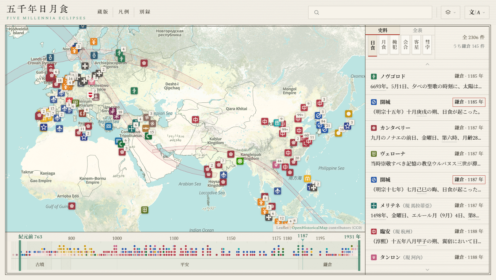
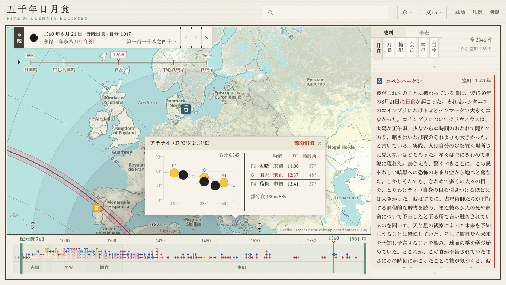
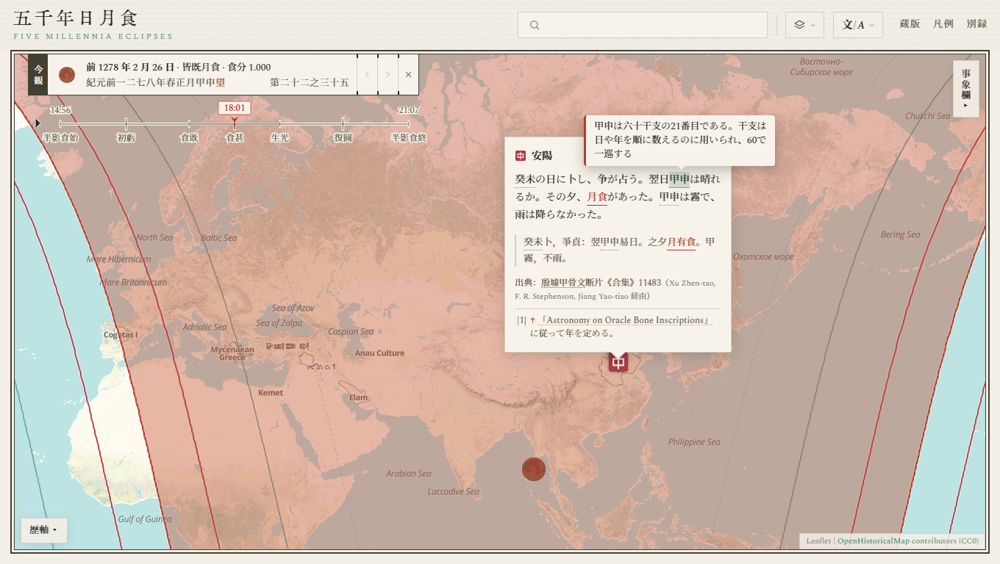
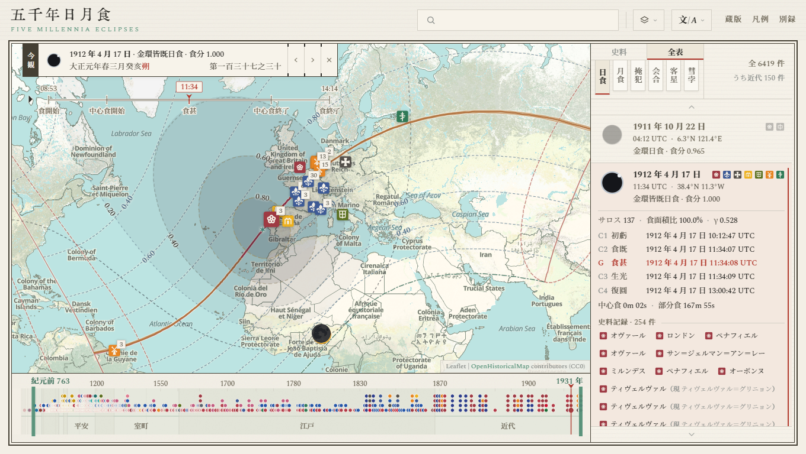

#  五千年日月食

[简体中文](../zh-Hans/README.md) · [繁體中文](../zh-Hant/README.md) · [English](../en/README.md) · [Français](../fr/README.md) · [Español](../es/README.md) · [Italiano](../it/README.md) · **日本語**

<p align="center">
  
</p>

**サイト**：<https://higashimado.github.io/FiveMillenniaEclipses/>

「**五千年日月食**」は、Leaflet・MapLibre GL JS の地図ライブラリと JSONL データ形式の上に構築した、歴史天文記録のオープンデータベースです。パブリックドメインの天象記録を一万件あまり収め、それぞれを天文計算と照合したうえで日付・地点・対象・出典などの注記を整え、ひとつの対話型歴史地図の上に示します。どの記録についても、その天象がいつ、どこで見られ、何と呼ばれ、実際には何であったのかが、地図上ですぐにわかります。

## 画面

メインページは上部バー、地図、歴軸、事象欄の四つの部分からなり、歴軸は下に、事象欄は右に置かれています。

- **上部バー**：検索欄では記録の原文・訳文・脚注・出典・地名・時期・文明などを検索できます。右側の選択メニューでは背景地図と表示言語を切り替えます。
- **地図**：既定の背景地図は [OpenHistoricalMap](https://www.openhistoricalmap.org/) で、地図上の要素は年代に応じて変わります。地図上の印章は各記録の属する文明と観測地点を示します。
- **歴軸**：焦点の近くを広く、遠くを狭く描く魚眼タイムラインです。焦点を調節でき、年の目盛りと時代の境界を備え、丸印が各記録の観測時期を示します。
- **事象欄**：史料・全表の二つの表示があり、それぞれ天象記録と天文事象を一覧にします。欄の上端の付箋で天象の種類を切り替え、右上の枠には件数の合計を表示します。

地図上の印章や一覧の項目をクリックすると、**事象詳細**モードに入ります。このモードでは次のものが表示されます。

- 地図には影錐の接触曲線と事象の可視範囲、および同じ事象を記した各記録の分布が現れます。
- 書耳には事象の概要と干支による日付が並び、その下のダイヤルで影錐の投影を時刻ごとに再生できます。
- 地図上の任意の地点をクリックすれば事象ポップアップが開き、その地点について計算した食況図と食程表が示されます。

<p align="center">
  
</p>

## 史料

本データベースには現在、天象記録 13,195 件が収められ、日本語訳は約 87 万字に及びます。記録の出典は 387 種、漢文・オランダ語・フランス語・英語・ラテン語・アラビア語・ギリシア語など 23 の言語にわたります。テキストは [ウィキソース](https://wikisource.org/)、[Delpher](https://www.delpher.nl/)、[Gallica](https://gallica.bnf.fr/)、[インターネットアーカイブ](https://archive.org/)、[Chronicling America](https://chroniclingamerica.loc.gov/)、[臺灣歷史數位圖書館](http://thdl.ntu.edu.tw/)、[モヌメンタ・ゲルマニアエ・ヒストリカ（dMGH）](https://www.dmgh.de/)、[NASA ADS](https://ui.adsabs.harvard.edu/) など 20 以上のデジタル図書館から採録しており、引用したテキストはいずれもパブリックドメインです。

### 分類

記録は目的と形式によって「史書」「新聞」「学術」「雑録」の四つに大別され、さらに 22 の小分類に分かれます。小分類は [`sources.json`](../data/records/sources.json) の `genre` フィールドに記されています。分類ごとに文体・主題・分量・詳しさが異なり、出典の一覧は [`SOURCES.md`](../SOURCES.md) にまとめてあります。

| 分類 | 小分類 | 出典 | 件数 | 件数比 | 和訳字数 | 字数比 | 年代 |
|---|---:|---:|---:|---:|---:|---:|---|
| 史書 | 6 | 103 | 11,948 | 90.5% | 338,171 | 38.9% | 前720 – 1911 |
| 新聞 | 6 | 186 | 1,043 | 7.9% | 463,977 | 53.4% | 1834 – 1941 |
| 学術 | 3 | 57 | 57 | 0.4% | 43,491 | 5.0% | 1715 – 1923 |
| 雑録 | 7 | 45 | 147 | 1.1% | 23,363 | 2.7% | 前2137 – 1842 |
| **合計** | **22** | **387** | **13,195** | | **869,002** | | **前2137 – 1941** |

**史書**は中国・日本・朝鮮・ベトナムの官撰史書を中心に、西アジアやヨーロッパの年代記も収めます。記載は途切れることなく連なり、体系的に分類され、書式も定まっています。典型例は[『宋史』天文志](https://zh.wikisource.org/wiki/%E5%AE%8B%E5%8F%B2/%E5%8D%B7053)です。**新聞**は近代に生まれたもので、書き手も視点もさまざまです。生活感あふれる市井の人々の姿を描いた記事もあれば、天象に託して時事を論じる社説や評論もあります。**学術**は天文学者ら専門家の手になる記録で、きわめて詳細です。とりわけ影響が大きいのは、一般相対性理論を検証した 1919 年の日食観測 [*The Expedition to Sobral*](https://archive.org/details/philtrans06337895) です。**雑録**は経書・史書・詩歌・日記・書簡・粘土板などを含みます。たとえば『詩経』の「日之を食する有り、亦孔だ之れ醜し」がそれで、最古の記録はすべてこの分類に属しますが、その年月や地点には異論の多いものも少なくありません。

<p align="center">
  
</p>

### 構成

史料データは [`data/records/`](../data/records/) に JSONL 形式で格納し、天象と文明ごとにファイルを分けています。各記録には原文・訳文・注釈のほか、日付・地点・文明・出典・信頼度などの注記が付いています。同じディレクトリの [`manifest.json`](../data/records/manifest.json) にはファイル一覧と件数、[`sources.json`](../data/records/sources.json) には書名・著者・巻や頁などの出典情報、[`visibility.json`](../data/records/visibility.json) には記録の記述と天文計算を照らし合わせて得た事象の可視性を収めています。

| ファイル | 内容 | 読み込み元 |
|---|---|---|
| [`data/records/README.md`](../data/records/README.md) | 形式の説明 | — |
| [`data/records/schema.json`](../data/records/schema.json) | フィールド定義 | — |
| [`data/records/manifest.json`](../data/records/manifest.json) | ファイル一覧 | [`js/atlas.js`](../js/atlas.js) |
| [`data/records/sources.json`](../data/records/sources.json) | 出典目録 | [`js/atlas.js`](../js/atlas.js) |
| [`data/records/visibility.json`](../data/records/visibility.json) | 可視性 | [`js/atlas.js`](../js/atlas.js) |
| [`data/records/`](../data/records/) `<天象>/<文明>.jsonl` | 記録本体 | [`js/atlas.js`](../js/atlas.js) |

`<天象>` は `solar`、`lunar`、`appulse`、`conjunction`、`guest`、`comet` のいずれかで、事象欄の六つの付箋に対応します。`<文明>` は `chinese` をはじめとする 33 種のいずれかで、詳しくは [`civilizations.json`](../data/concordance/civilizations.json) を参照してください。

## 全表

本データベースの天文事象全表は、[天文学的紀年法](https://ja.wikipedia.org/wiki/天文学的紀年法)で −3000 年から 1999 年までの日食 11,871 回、月食 12,031 回を収めます。日食のベッセル要素、月食のサロス番号とガンマ値は NASA／Espenak の[五千年日月食典 5MCSE / 5MCLE](https://eclipse.gsfc.nasa.gov/) から取り、接触曲線は [SubstellarAtlas](https://github.com/Higashimado/SubstellarAtlas) の幾何ツールで計算しています。食典は紀元前 2000 年から始まるため、それより前の年代については [JPL DE441](https://ssd.jpl.nasa.gov/planets/eph_export.html) 暦表をもとに独自に算出しました。その結果の経度の標準偏差は 4.48° から 7.30° の範囲にあります。

| ファイル | 内容 | 読み込み元 | 件数 | サイズ |
|---|---|---|---:|---:|
| [`data/eclipses/README.md`](../data/eclipses/README.md) | 形式の説明 | — | | |
| [`data/eclipses/solar.json`](../data/eclipses/solar.json) | 日食索引 | [`js/eclipse-loader.js`](../js/eclipse-loader.js) | 11,871 | 9.7 MB |
| [`data/eclipses/lunar.json`](../data/eclipses/lunar.json) | 月食索引 | [`js/eclipse-loader.js`](../js/eclipse-loader.js) | 12,031 | 9.7 MB |
| [`data/eclipses/events/`](../data/eclipses/events/) `<日付>.json` | 接触曲線とベッセル多項式 | [`js/eclipse.js`](../js/eclipse.js) | 11,871 | 386 MB |
| [`data/eclipses/bessel-5mcse.json`](../data/eclipses/bessel-5mcse.json) | 5MCSE のベッセル要素 | — | 9,506 | 5.8 MB |
| [`data/eclipses/bessel-ancient.json`](../data/eclipses/bessel-ancient.json) | DE441 から独自算出したベッセル要素 | — | 2,365 | 2.1 MB |

`<日付>` は [ISO 8601](https://web.archive.org/web/20171019211402/https://www.loc.gov/standards/datetime/ISO_DIS%208601-1.pdf) が定める天文学的日付で、`-000762-06-07`、`1931-10-11` のように書きます。

<p align="center">
  
</p>

## 対照

本データベースの対照表は、出典によって呼び名の異なる対象のメタデータを統一するためのものです。天体なら「熒惑」と「火星」、地名なら「応天」と「南京」といった対応を定め、史料と全表の関連フィールドの根拠とします。たとえば [`gazetteer.json`](../data/concordance/gazetteer.json) には天象記録の観測地の名称と座標、[`xingguan.json`](../data/concordance/xingguan.json) には星官の名称・範囲・連線、[`eras.json`](../data/concordance/eras.json) には中国・朝鮮・日本・ベトナム・西夏の年号の名称・王朝と対応する天文学的紀年を収めています。このほか人名・暦法・術語などの表があります。詳しくは各ファイル冒頭の `_meta` フィールドの定義を参照してください。

| ファイル | 内容 | 読み込み元 | 件数 |
|---|---|---|---:|
| [`data/concordance/README.md`](../data/concordance/README.md) | 形式の説明 | — | |
| [`data/concordance/gazetteer.json`](../data/concordance/gazetteer.json) | 地点 | [`js/atlas.js`](../js/atlas.js)、[`js/place-name.js`](../js/place-name.js) | 573 |
| [`data/concordance/regions.json`](../data/concordance/regions.json) | 地域 | [`js/atlas.js`](../js/atlas.js)、[`js/place-name.js`](../js/place-name.js) | 124 |
| [`data/concordance/civilizations.json`](../data/concordance/civilizations.json) | 文明 | [`js/atlas.js`](../js/atlas.js)、[`js/seal.js`](../js/seal.js) | 33 |
| [`data/concordance/persons.json`](../data/concordance/persons.json) | 人名 | [`js/atlas.js`](../js/atlas.js) | 76 |
| [`data/concordance/organizations.json`](../data/concordance/organizations.json) | 機関名 | — | 52 |
| [`data/concordance/terms.json`](../data/concordance/terms.json) | 術語 | [`js/atlas.js`](../js/atlas.js) | 86 |
| [`data/concordance/calendars.json`](../data/concordance/calendars.json) | 暦法 | [`js/atlas.js`](../js/atlas.js) | 15 |
| [`data/concordance/eras.json`](../data/concordance/eras.json) | 年号 | [`js/atlas.js`](../js/atlas.js)、[`js/supplied.js`](../js/supplied.js) | 830 |
| [`data/concordance/xingguan.json`](../data/concordance/xingguan.json) | 中国の星名 | [`js/atlas.js`](../js/atlas.js) | 412 |
| [`data/concordance/bodies.json`](../data/concordance/bodies.json) | 天体名 | [`js/atlas.js`](../js/atlas.js)、[`js/supplied.js`](../js/supplied.js) | 8 |

[`js/atlas.js`](../js/atlas.js) が読み込む対照表は、印章・地名・ポップアップ・脚注などページの描画に使われます。

## 実行

フロントエンドはビルド手順のない静的サイトです。ローカルでのプレビューには [Node.js](https://nodejs.org/) が必要で、ソースをクローンしたあとルートディレクトリで次のコマンドを実行します。

```bash
npm start
```

続いてブラウザで <http://localhost:8002> を開き、正しく表示されることを確かめます。

## ディレクトリ

- [`index.html`](../index.html)、[`js/`](../js/)、[`css/`](../css/)：フロントエンドのページ
- [`vendor/`](../vendor/)：外部ライブラリ
- [`data/`](../data/)：史料・全表・対照・多言語データ。形式の取り決めは [`data/README.md`](../data/README.md) を参照
- [`licenses/`](../licenses/)：ライセンス全文
- [`serve.mjs`](../serve.mjs)：ローカルプレビュー用サーバー

## 謝辞とライセンス

本プロジェクト独自のコードは [**GNU General Public License v3.0**](../LICENSE) で公開しています。[`data/records/`](../data/records/)、[`data/eclipses/`](../data/eclipses/) と [`data/concordance/`](../data/concordance/) は [**CC-BY-SA 4.0**](../licenses/data/CC-BY-SA-4.0.txt) で公開しています。第三者のコード・データ・フォントはそれぞれのライセンスに従い、クレジットの詳細は [`ATTRIBUTION.md`](../ATTRIBUTION.md) に記しています。

| 用途 | コンポーネント（バージョン） | 作者・提供元 | ライセンス |
|---|---|---|---|
| 影錐幾何 | [SubstellarAtlas](https://github.com/Higashimado/SubstellarAtlas) | Higashimado | GPL-3.0 |
| 地図エンジン | [Leaflet](https://leafletjs.com/) 1.9.4 | Volodymyr Agafonkin | BSD-2-Clause |
| ベクター描画 | [MapLibre GL JS](https://maplibre.org/) 5.24.0 | MapLibre | BSD-3-Clause |
| レイヤー連携 | [maplibre-gl-leaflet](https://github.com/maplibre/maplibre-gl-leaflet) 0.1.3 | MapLibre | ISC |
| 時期フィルター | [maplibre-gl-dates](https://github.com/OpenHistoricalMap/maplibre-gl-dates) 1.3.0 | OpenHistoricalMap | CC0-1.0 |
| 天文計算 | [Astronomy Engine](https://github.com/cosinekitty/astronomy) 2.1.19 | Don Cross | MIT |
| 日月食典 | [5MCSE / 5MCLE](https://eclipse.gsfc.nasa.gov/) | Fred Espenak（NASA GSFC） | パブリックドメイン（クレジット表記を要請） |
| 古代暦表 | [JPL DE441](https://ssd.jpl.nasa.gov/planets/eph_export.html) | JPL | パブリックドメイン |
| 自転変動 | [Stephenson, Morrison & Hohenkerk 2016](https://doi.org/10.1098/rspa.2016.0404) | Royal Society | CC BY 4.0 |
| 史料底本 | [ウィキソース](https://wikisource.org/) | ウィキソース寄稿者 | CC-BY-SA 4.0 |
| 史料底本 | [Delpher](https://www.delpher.nl/)、[Gallica](https://gallica.bnf.fr/)、[インターネットアーカイブ](https://archive.org/)、[Chronicling America](https://chroniclingamerica.loc.gov/) など | 各所蔵機関 | パブリックドメイン |
| 歴史地図 | [OpenHistoricalMap](https://www.openhistoricalmap.org/) | OHM コミュニティ | データは CC0 |
| 現代地図 | [CARTO](https://carto.com/) Positron · Voyager | CARTO | © CARTO |
| 現代地図 | [OpenStreetMap](https://www.openstreetmap.org/) 標準レイヤー | OSM 寄稿者 | ODbL |
| 地形地図 | [Esri World Shaded Relief](https://www.esri.com/) | Esri / USGS | © Esri |
| 地図データ | [OpenStreetMap](https://www.openstreetmap.org/copyright) | OSM 寄稿者 | ODbL |
| CJK フォント | [Source Han Serif](https://github.com/adobe-fonts/source-han-serif) 源ノ明朝 | Adobe | OFL |
| 欧文フォント | [Spectral](https://fonts.google.com/specimen/Spectral) | Production Type | OFL |
| セリフ体フォント | [Noto Serif](https://fonts.google.com/noto) · Naskh Arabic · Serif Armenian · Serif Hebrew | Google | OFL |
| 題字フォント | [KingHwaOldSong](https://fonts.zeoseven.com/) 京華老宋体 | ZeoSeven Fonts | [ライセンスファイル](../licenses/fonts/KingHwaOldSong-LICENSE.md)を参照 |

記録の数が多いため、遺漏や誤りは避けられません。補遺・訂正、そして根拠に基づく異論は [issues](https://github.com/Higashimado/FiveMillenniaEclipses/issues) にお寄せください。
