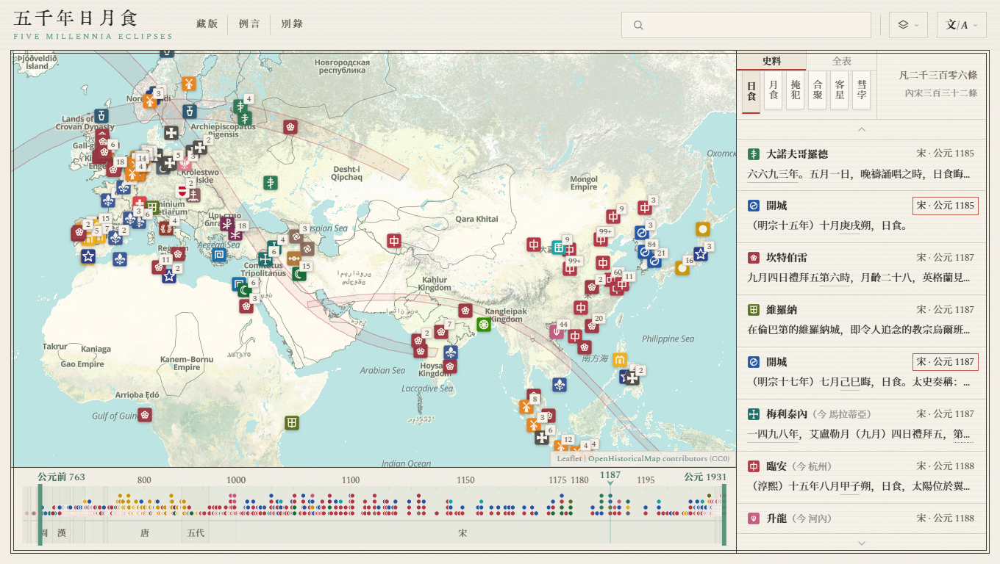
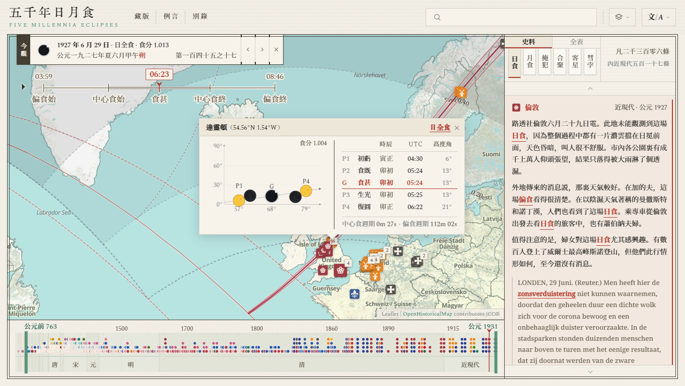

#  五千年日月食

[简体中文](../zh-Hans/README.md) · **繁體中文** · [English](../en/README.md) · [Français](../fr/README.md) · [Español](../es/README.md) · [Italiano](../it/README.md) · [日本語](../ja/README.md)

<p align="center">
  
</p>

**網站連結**：<https://higashimado.github.io/FiveMillenniaEclipses/>

「**五千年日月食**」是基於 Leaflet、MapLibre GL JS 地圖架構與 JSONL 資料格式建構的開放歷史天文記錄資料庫，其收錄有各類公有領域的萬餘條歷史天象記錄，比對天文推算，整理日期、地點、對象、來源等標註，並呈現於統一的可互動歷史地圖之上。何時何地，何名何物，一覽可稽。

## 頁面

網站主頁面由頂欄、地圖、歷軸、右欄四部分組成，歷軸居下，右欄居右：

- **頂欄**：搜尋框可匹配原文、譯文、註釋、來源、地名、時間、文明等以篩選記錄，選項框可切換地圖底圖和介面語言
- **地圖**：[OpenHistoricalMap](https://www.openhistoricalmap.org/) 為預設底圖，地圖要素隨年代變化，印章標示記錄的所屬文明與觀測地點
- **歷軸**：魚眼時間軸，焦點可調節，附有年份刻度與朝代分界，圓點標示記錄的觀測時間
- **右欄**：分史料、全表兩種檢視，分別列出天象記錄與天文事件，欄頂浮簽用於切換天象類型

點選地圖上的印章或列表中的條目，即可進入**事件詳情**模式，該模式下：

- 地圖將顯示影錐的接觸曲線和事件的可見範圍，以及同場事件的各記錄分布
- 書耳會列出事件的概況資料與干支紀日，書耳下的撥盤可逐時播放影錐投影
- 點選地圖上的任意地點，將顯示事件彈出視窗，上附該地推算的食況圖與食程表

<p align="center">
  
</p>

## 史料

本庫目前存有天象記錄共 13 159 條，漢譯文本約 53 萬字。記錄引自 381 種來源，涉漢文、荷蘭語、法語、英語、拉丁語、阿拉伯語、希臘語等 23 種語言，取自 [維基文庫](https://wikisource.org/)、[Delpher](https://www.delpher.nl/)、[Gallica](https://gallica.bnf.fr/)、[網際網路檔案館](https://archive.org/)、[Chronicling America](https://chroniclingamerica.loc.gov/)、[臺灣歷史數位圖書館](http://thdl.ntu.edu.tw/)、[德意志歷史文獻集成 dMGH](https://www.dmgh.de/) 與 [NASA ADS](https://ui.adsabs.harvard.edu/) 等 20 餘個數位圖書館，所引文本版權均為公有。

### 體裁

依目的和形式的不同，本庫記錄的體裁可大致分為「史冊」「報刊」「學志」「雜錄」四類，此下再細分 19 種小類。小類記於 [`sources.json`](../data/records/sources.json) 的 `genre` 欄位。不同體裁的記錄風格、主題、篇幅及詳略各不相同，詳見 [`SOURCES.md`](../SOURCES.md)．

| 類別 | 小類 | 來源 | 條數 | 條數佔比 | 漢譯字數 | 字數佔比 | 年代 |
|---|---:|---:|---:|---:|---:|---:|---|
| 史冊 | 6 | 92 | 12 012 | 91.3% | 214 267 | 40.5% | 前 720 – 1911 |
| 報刊 | 6 | 186 | 1 000 | 7.6% | 281 639 | 53.3% | 1834 – 1941 |
| 學志 | 3 | 55 | 55 | 0.4% | 23 852 | 4.5% | 1715 – 1923 |
| 雜錄 | 4 | 50 | 92 | 0.7% | 8 737 | 1.7% | 前 2137 – 1842 |
| **合計** | **19** | **381** | **13 159** | | **528 495** | | **前 2137 – 1941** |

**史冊**以中、日、朝、越官修史書為主體，兼收西亞、歐洲編年史，載錄連續、分類齊全、格式規整，典例有如[《宋史·天文志》](https://zh.wikisource.org/wiki/%E5%AE%8B%E5%8F%B2/%E5%8D%B7053)。**報刊**是近代產物，來源豐富、視角多樣，既有富生活氣息的市民群像，又有以天象喻事之社論雜文。**學志**為專業人士撰寫，記錄翔實、影響深遠，最重要的莫如 1919 年驗證廣義相對論之日食觀測 [*The Expedition to Sobral*](https://archive.org/details/philtrans06337895)．**雜錄**則含經書、史著、詩歌、日記、書信與泥板等，如《詩經》之「日有食之，亦孔之醜」，上古記錄盡出於此，然其所繫年月、地點多有爭議。

### 結構

史料資料存放於 [`data/records/`](../data/records/)，以 JSONL 格式儲存，按天象與文明分類。每條記錄含原文、譯文、註釋，以及日期、地點、文明、來源、可信度等標註。該目錄下的 [`manifest.json`](../data/records/manifest.json) 存放檔案列表與條目數量，[`sources.json`](../data/records/sources.json) 存放書名、作者、卷頁等來源資訊，[`visibility.json`](../data/records/visibility.json) 存放比對記錄描述與天文推算所得的事件可見性。

| 檔案 | 內容 | 呼叫 |
|---|---|---|
| [`data/records/README.md`](../data/records/README.md) | 格式說明 | — |
| [`data/records/schema.json`](../data/records/schema.json) | 欄位定義 | — |
| [`data/records/manifest.json`](../data/records/manifest.json) | 檔案清單 | [`js/atlas.js`](../js/atlas.js) |
| [`data/records/sources.json`](../data/records/sources.json) | 來源目錄 | [`js/atlas.js`](../js/atlas.js) |
| [`data/records/visibility.json`](../data/records/visibility.json) | 可見性 | [`js/atlas.js`](../js/atlas.js) |
| [`data/records/`](../data/records/) `<天象>/<文明>.jsonl` | 記錄原件 | [`js/atlas.js`](../js/atlas.js) |

`<天象>` 可取 `solar`、`lunar`、`occultation`、`conjunction`、`guest`、`comet`，與右欄的六類浮簽一致。`<文明>` 可取 `chinese` 等 33 種，詳見 [`civilizations.json`](../data/concordance/civilizations.json)．

## 全表

本庫的天文事件全表收錄 [天文紀年](https://zh.wikipedia.org/zh-tw/天文計年) −3000 至 1999 年的日食 11 871 場、月食 12 031 場。日食的貝塞爾根數、月食的沙羅序號和伽馬值取自 NASA/Espenak [五千年日月食典 5MCSE / 5MCLE](https://eclipse.gsfc.nasa.gov/)，接觸曲線由 [SubstellarAtlas](https://github.com/Higashimado/SubstellarAtlas) 的幾何工具計算。由於食典年代起自公元前 2000 年，更早年代無典可依，本庫即按 [JPL DE441](https://ssd.jpl.nasa.gov/planets/eph_export.html) 星曆自行推算，結果的經度標準差在 4.48° 到 7.30° 之間。

| 檔案 | 內容 | 呼叫 | 條目 | 大小 |
|---|---|---|---:|---:|
| [`data/eclipses/README.md`](../data/eclipses/README.md) | 格式說明 | — | | |
| [`data/eclipses/solar.json`](../data/eclipses/solar.json) | 日食索引 | [`js/eclipse-loader.js`](../js/eclipse-loader.js) | 11 871 | 9.7 MB |
| [`data/eclipses/lunar.json`](../data/eclipses/lunar.json) | 月食索引 | [`js/eclipse-loader.js`](../js/eclipse-loader.js) | 12 031 | 9.7 MB |
| [`data/eclipses/events/`](../data/eclipses/events/) `<日期>.json` | 接觸曲線與貝塞爾多項式 | [`js/eclipse.js`](../js/eclipse.js) | 11 871 | 386 MB |
| [`data/eclipses/bessel-5mcse.json`](../data/eclipses/bessel-5mcse.json) | 5MCSE 貝塞爾根數 | — | 9 506 | 5.8 MB |
| [`data/eclipses/bessel-ancient.json`](../data/eclipses/bessel-ancient.json) | DE441 自算貝塞爾根數 | — | 2 365 | 2.1 MB |

`<日期>` 為 [ISO 8601](https://web.archive.org/web/20171019211402/https://www.loc.gov/standards/datetime/ISO_DIS%208601-1.pdf) 定義的天文日期，如 `-000762-06-07`、`1931-10-11`．

## 對照

本庫的對照表用於統一多源異名對象的後設資料，如天文對象的「熒惑」之於「火星」，地理對象的「應天」之於「南京」等，以作史料和全表相關欄位的憑據。例如，[`gazetteer.json`](../data/concordance/gazetteer.json) 存放天象記錄中觀測地的名稱、座標，[`xingguan.json`](../data/concordance/xingguan.json) 存放星官的名稱、範圍與連線，[`nianhao.json`](../data/concordance/nianhao.json) 存放中國年號的名稱、朝代及對應的天文紀年。同一對象或有簡寫、別名，或在不同的時間範圍內有特定名稱，詳見各檔案頭部 `_meta` 欄位的定義。

| 檔案 | 內容 | 呼叫 | 條目 |
|---|---|---|---:|
| [`data/concordance/README.md`](../data/concordance/README.md) | 格式說明 | — | |
| [`data/concordance/gazetteer.json`](../data/concordance/gazetteer.json) | 地點 | [`js/atlas.js`](../js/atlas.js)、[`js/place-name.js`](../js/place-name.js) | 546 |
| [`data/concordance/regions.json`](../data/concordance/regions.json) | 區域 | [`js/atlas.js`](../js/atlas.js)、[`js/place-name.js`](../js/place-name.js) | 124 |
| [`data/concordance/civilizations.json`](../data/concordance/civilizations.json) | 文明 | [`js/atlas.js`](../js/atlas.js)、[`js/seal.js`](../js/seal.js) | 33 |
| [`data/concordance/organizations.json`](../data/concordance/organizations.json) | 機構名稱 | — | 52 |
| [`data/concordance/xingguan.json`](../data/concordance/xingguan.json) | 中國星名 | — | 413 |
| [`data/concordance/nianhao.json`](../data/concordance/nianhao.json) | 中國年號 | [`js/atlas.js`](../js/atlas.js) | 330 |
| [`data/concordance/nengo.json`](../data/concordance/nengo.json) | 日本元號 | [`js/atlas.js`](../js/atlas.js) | 241 |

## 執行

本庫前端為靜態站點，無建置步驟，本機預覽需有 [Node.js](https://nodejs.org/)，複製原始碼後在根目錄執行：

```bash
npm start
```

隨後，在瀏覽器開啟 <http://localhost:8002>，檢查是否正常顯示即可。

## 目錄

- [`index.html`](../index.html)、[`js/`](../js/)、[`css/`](../css/)：前端頁面
- [`vendor/`](../vendor/)：外部函式庫
- [`data/`](../data/)：史料、全表、對照與多語言，格式約定見 [`data/README.md`](../data/README.md)
- [`licenses/`](../licenses/)：授權全文
- [`serve.mjs`](../serve.mjs)：本機預覽

## 致謝與授權

本專案自有程式碼以 [**GNU General Public License v3.0**](../LICENSE) 釋出。[`data/records/`](../data/records/)、[`data/eclipses/`](../data/eclipses/) 與 [`data/concordance/`](../data/concordance/) 以 [**CC-BY-SA 4.0**](../licenses/data/CC-BY-SA-4.0.txt) 釋出。第三方程式碼、資料與字型遵循各自的授權，署名詳見 [`ATTRIBUTION.md`](../ATTRIBUTION.md)．

| 用途 | 元件（版本） | 作者或來源 | 授權 |
|---|---|---|---|
| 影錐幾何 | [SubstellarAtlas](https://github.com/Higashimado/SubstellarAtlas) | Higashimado | GPL-3.0 |
| 地圖引擎 | [Leaflet](https://leafletjs.com/) 1.9.4 | Volodymyr Agafonkin | BSD-2-Clause |
| 向量渲染 | [MapLibre GL JS](https://maplibre.org/) 5.24.0 | MapLibre | BSD-3-Clause |
| 圖層橋接 | [maplibre-gl-leaflet](https://github.com/maplibre/maplibre-gl-leaflet) 0.1.3 | MapLibre | ISC |
| 時間篩選 | [maplibre-gl-dates](https://github.com/OpenHistoricalMap/maplibre-gl-dates) 1.3.0 | OpenHistoricalMap | CC0-1.0 |
| 天文計算 | [Astronomy Engine](https://github.com/cosinekitty/astronomy) 2.1.19 | Don Cross | MIT |
| 日月食典 | [5MCSE / 5MCLE](https://eclipse.gsfc.nasa.gov/) | Fred Espenak（NASA GSFC） | 公有領域，須署名 |
| 古代星曆 | [JPL DE441](https://ssd.jpl.nasa.gov/planets/eph_export.html) | JPL | 公有領域 |
| 自轉誤差 | [Stephenson, Morrison & Hohenkerk 2016](https://doi.org/10.1098/rspa.2016.0404) | Royal Society | CC BY 4.0 |
| 史料底本 | [維基文庫](https://wikisource.org/) | Wikisource 貢獻者 | CC-BY-SA 4.0 |
| 史料底本 | [Delpher](https://www.delpher.nl/)、[Gallica](https://gallica.bnf.fr/)、[網際網路檔案館](https://archive.org/)、[Chronicling America](https://chroniclingamerica.loc.gov/) 等 | 各收藏機構 | 公有領域 |
| 歷史底圖 | [OpenHistoricalMap](https://www.openhistoricalmap.org/) | OHM 社群 | 資料 CC0 |
| 現代底圖 | [CARTO](https://carto.com/) Positron · Voyager | CARTO | © CARTO |
| 現代底圖 | [OpenStreetMap](https://www.openstreetmap.org/) 標準圖層 | OSM 貢獻者 | ODbL |
| 地形底圖 | [Esri World Shaded Relief](https://www.esri.com/) | Esri / USGS | © Esri |
| 底圖資料 | [OpenStreetMap](https://www.openstreetmap.org/copyright) | OSM 貢獻者 | ODbL |
| CJK 字型 | [Source Han Serif](https://github.com/adobe-fonts/source-han-serif) 思源宋體 | Adobe | OFL |
| 西文字型 | [Spectral](https://fonts.google.com/specimen/Spectral) | Production Type | OFL |
| 襯線字型 | [Noto Serif](https://fonts.google.com/noto) · Naskh Arabic · Serif Armenian · Serif Hebrew | Google | OFL |
| 題銘字型 | [KingHwaOldSong](https://fonts.zeoseven.com/) 京華老宋體 | ZeoSeven Fonts | 見[授權檔案](../licenses/fonts/KingHwaOldSong-LICENSE.md) |

本庫史料浩繁，疏漏、訛誤在所難免。如有補遺、勘誤或示以考證，歡迎在 [issues](https://github.com/Higashimado/FiveMillenniaEclipses/issues) 留言指正。
